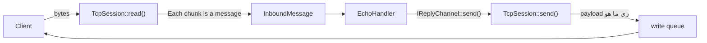
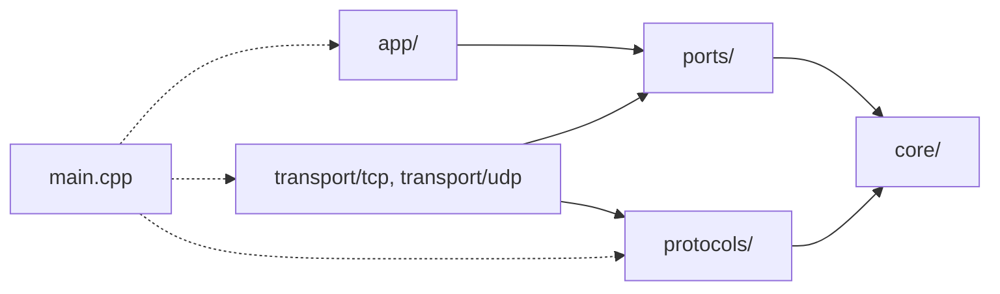
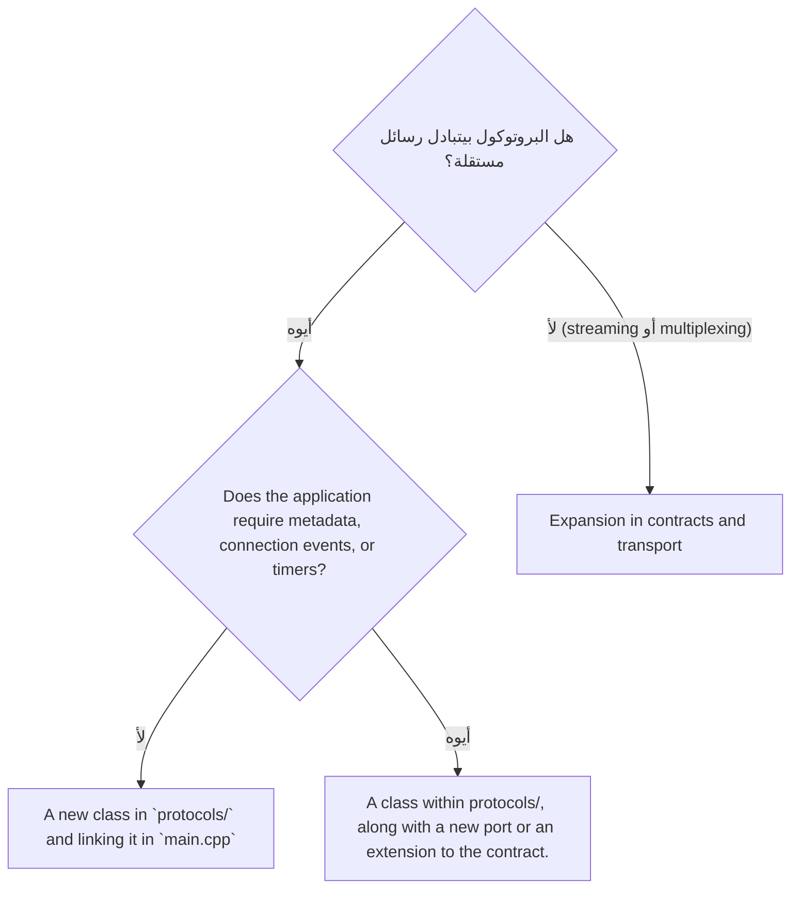

# قابلية توسعة البروتوكولات: المشكلة، وطريقة التفكير، والحل

المستند ده بيجاوب على سؤال معماري واحد، وبيفصل بوضوح بين حاجتين:

- **[حالي]**: حاجة موجودة فعلًا في الكود دلوقتي.
- **[مخطط]**: حاجة مقترحة لسه متنفذتش.

## الفهرس

1. [السؤال](#1-السؤال)
2. [الإجابة المختصرة](#2-الإجابة-المختصرة)
3. [الوضع الحالي: إيه اللي موجود فعلًا](#3-الوضع-الحالي-إيه-اللي-موجود-فعلًا)
4. [حدود المعمارية الحالية (Limitations)](#4-حدود-المعمارية-الحالية-limitations)
5. [إزاي بنفكر في المشكلة](#5-إزاي-بنفكر-في-المشكلة)
6. [الحل المقترح](#6-الحل-المقترح)
7. [بعد الحل: إيه اللي هيبقى سهل وإيه اللي لأ](#7-بعد-الحل-إيه-اللي-هيبقى-سهل-وإيه-اللي-لأ)
8. [خطة التنفيذ](#8-خطة-التنفيذ)
9. [أسئلة قبل إضافة أي بروتوكول](#9-أسئلة-قبل-إضافة-أي-بروتوكول)

---

## 1. السؤال

> لو حبيت أضيف بروتوكول جديد بيشتغل فوق TCP أو UDP، زي WebSocket أو بروتوكول binary خاص بيا، هل المعمارية دي هتخليني أعمل ده بسهولة؟

---

## 2. الإجابة المختصرة

<div dir="rtl">
<table dir="rtl">
  <thead>
    <tr>
      <th style="text-align: center;">&nbsp;</th>
      <th style="text-align: center;">الإجابة</th>
    </tr>
  </thead>
  <tbody>
    <tr>
      <td><strong>على الكود الحالي</strong></td>
      <td>
        <strong>نص سهل ونص صعب.</strong>
        منطق التطبيق (<code dir="ltr">app/</code>) والعقود (<code dir="ltr">ports/</code> و<code dir="ltr">core/</code>) مش هيتعدلوا لأي بروتوكول بيتبادل رسائل.
        لكن طبقة النقل <strong>مش قابلة للتوسعة</strong>:
        أي بروتوكول فوق <span dir="ltr">TCP</span> معناه إنك تعدّل في <code dir="ltr">TcpSession</code> نفسه،
        وأي بروتوكول فوق <span dir="ltr">UDP</span> معناه إنك تكتب <code dir="ltr">UdpServer</code> من الأول.
      </td>
    </tr>
    <tr>
      <td><strong>بعد الحل المقترح</strong></td>
      <td>
        البروتوكولات البسيطة هتبقى <strong><span dir="ltr">class</span> جديد وسطر في <code dir="ltr">main.cpp</code></strong>.
        والبروتوكولات المعقدة هتحتاج توسعة في العقود،
        بس في <strong>أماكن معروفة ومحدودة</strong>.
      </td>
    </tr>
  </tbody>
</table>
</div>

---

## 3. الوضع الحالي: إيه اللي موجود فعلًا

### الملفات **[حالي]**

```
include/netserver/
├── core/        Message, PeerInfo
├── ports/       IMessageEndpoint, IReplyChannel, InboundMessage, InboundMessageHandler
├── app/         EchoHandler
├── transport/
│   └── tcp/     TcpServer, TcpSession
└── common/      debug.hpp
```

مفيش `protocols/`، ومفيش `transport/udp/`.

### رحلة الرسالة النهارده **[حالي]**



الكود المسؤول عن ده في [TcpSession.cpp](../src/transport/tcp/TcpSession.cpp):

```cpp
// read(): every async_read_some() result becomes one message
InboundMessage inbound{
    Message{std::string(m_read_buffer.data(), bytes_read)},
    m_peer,
    self
};
m_on_message(inbound);

// send(): the payload is written to the socket as-is
m_write_queue.push_back(std::move(message.payload));
```
#### What the quote "Each chunk is a message" means?

**"كل chunk يبقى رسالة"** معناها إن أي دفعة بايتات بترجع من قراءة واحدة على الـ socket، الكود بيتعامل معاها على إنها رسالة كاملة ويبعتها للتطبيق، حتى لو هي في الحقيقة مش رسالة كاملة.

##### يعني إيه chunk؟

الـ **chunk** هو اللي بترجعه `async_read_some()` في المرة الواحدة. ده عبارة عن البايتات اللي كانت موجودة في الـ receive buffer بتاع الـ kernel ساعة القراءة، وبحد أقصى 1024 بايت، وده حجم `m_read_buffer`.

والكود الحالي بيعمل كدا:

```cpp
m_socket.async_read_some(asio::buffer(m_read_buffer),
    [this, self](const asio::error_code& error, std::size_t bytes_read) {
        // whatever arrived in this read becomes one Message
        InboundMessage inbound{
            Message{std::string(m_read_buffer.data(), bytes_read)}, m_peer, self};
        m_on_message(inbound);
        ...
    });
```

يعني كل مرة القراءة ترجع، `EchoHandler::on_message()` بيتنادى مرة واحدة باللي وصل.

##### فين المشكلة؟

ال TCP بينقل **تيار بايتات متصل (byte stream)**، ومش بيحتفظ بحدود الرسائل اللي العميل بعتها. فلو العميل بعت رسالتين:

```c++
send("Hello")
send("World")
```

السيرفر ممكن يقراهم بأي شكل من دول:

<div dir="rtl">
<table dir="rtl">
  <thead>
    <tr>
      <th style="text-align: center;">اللي وصل</th>
      <th style="text-align: center;">عدد مرات القراءة</th>
      <th style="text-align: center;">التطبيق هيشوف إيه</th>
    </tr>
  </thead>
  <tbody>
    <tr>
      <td><code dir="ltr">Hello</code> بعدها <code dir="ltr">World</code></td>
      <td>2</td>
      <td>رسالتين صح، وده بالصدفة</td>
    </tr>
    <tr>
      <td><code dir="ltr">HelloWorld</code></td>
      <td>1</td>
      <td><strong>رسالة واحدة</strong> ملزوقة</td>
    </tr>
    <tr>
      <td><code dir="ltr">Hel</code> بعدها <code dir="ltr">loWorld</code></td>
      <td>2</td>
      <td>رسالتين <strong>مقطوعين غلط</strong></td>
    </tr>
  </tbody>
</table>
</div>

وكمان لو العميل بعت رسالة حجمها 3000 بايت، السيرفر هيقراها على الأقل 3 مرات (1024 + 1024 + 952)، والتطبيق هيفتكرها 3 رسايل.

##### طب ليه الـ echo شغال كويس؟

لأن الـ echo مش مهتم بمعنى البيانات. بيرجّع البايتات بنفس ترتيبها، فالعميل بيستقبل نفس التيار اللي بعته، أيًا كان التقسيم في النص.

لكن لو التطبيق بيفهم البيانات، زي أوامر أو JSON أو بروتوكول binary، هيبوظ:

```
The client sent:  {"cmd":"login"} and then {"cmd":"list"}
The server read:  {"cmd":"login"}{"cmd":"li      ← invalid JSON

                  st"}                          ← invalid JSON
```

##### الحل

محتاجين **framing**، يعني قاعدة متفق عليها بين العميل والسيرفر بتحدد الرسالة بتبدأ وبتخلص فين. مثلًا:

<div dir="rtl">
<ul>
  <li><strong><span dir="ltr">Length-prefix</span>:</strong> كل رسالة قبلها 4 بايت بيقولوا طولها.</li>
  <li><strong><span dir="ltr">Delimiter</span>:</strong> كل رسالة بتخلص بـ <code dir="ltr">\n</code>.</li>
</ul>
</div>

ساعتها السيرفر يجمّع البايتات في buffer، وما يبعتش رسالة للتطبيق غير لما تكمل، مهما كان التقسيم اللي حصل في الـ chunks. ده هو L2 في المستند، ومكانه `LengthPrefixProtocol` في خطة التنفيذ.


### اللي معمول صح وبيساعد على التوسعة **[حالي]**

<div dir="rtl">
<table dir="rtl">
  <thead>
    <tr>
      <th style="text-align: center;">الميزة</th>
      <th style="text-align: center;">ليه مهمة</th>
    </tr>
  </thead>
  <tbody>
    <tr>
      <td><code dir="ltr">EchoHandler</code> مش بيعرف أي حاجة عن <span dir="ltr">Asio</span> أو الـ <span dir="ltr">sockets</span></td>
      <td>تقدر تغيّر النقل أو البروتوكول من غير ما تلمس التطبيق.</td>
    </tr>
    <tr>
      <td><code dir="ltr">IReplyChannel</code></td>
      <td>التطبيق بيرد من غير ما يعرف الرد رايح فين ولا إزاي.</td>
    </tr>
    <tr>
      <td><code dir="ltr">InboundMessageHandler</code> في ملف لوحده</td>
      <td>أي <span dir="ltr">transport</span> جديد يقدر يستخدمه من غير ما يعتمد على <code dir="ltr">IMessageEndpoint</code>.</td>
    </tr>
    <tr>
      <td><code dir="ltr">IMessageEndpoint</code> و<code dir="ltr">main.cpp</code> بيمسك الـ <span dir="ltr">server</span> كـ <span dir="ltr">interface</span></td>
      <td>إضافة <span dir="ltr">endpoint</span> جديد ما بتغيّرش طريقة التشغيل والإيقاف.</td>
    </tr>
    <tr>
      <td><code dir="ltr">core/</code> مش بيعتمد على أي حاجة</td>
      <td>الأنواع الأساسية ثابتة ومش مربوطة بأي تقنية.</td>
    </tr>
    <tr>
      <td>الـ <span dir="ltr">write queue</span> والـ <span dir="ltr">backpressure</span> والإغلاق</td>
      <td>دي أصعب حاجات في الكود، ومكتوبة مرة واحدة.</td>
    </tr>
  </tbody>
</table>
</div>

---

## 4. حدود المعمارية الحالية (Limitations)

### ملخص

<style>
  table.rtl-center th { text-align: center; }
</style>

<div dir="rtl">
<table class="rtl-center" dir="rtl">
  <thead>
    <tr>
      <th>#</th>
      <th>الحد</th>
      <th>بيأثر على</th>
    </tr>
  </thead>
  <tbody>
    <tr>
      <td>L1</td>
      <td>النقل والبروتوكول متلزقين في <code dir="ltr">TcpSession</code></td>
      <td>أي بروتوكول فوق <span dir="ltr">TCP</span></td>
    </tr>
    <tr>
      <td>L2</td>
      <td>مفيش <span dir="ltr">framing</span>، وحدود الرسالة هي حدود القراءة</td>
      <td>أي بروتوكول فيه رسائل</td>
    </tr>
    <tr>
      <td>L3</td>
      <td>بيانات خاصة بالتطبيق جوه طبقة النقل</td>
      <td>أي بروتوكول فيه <span dir="ltr">handshake</span></td>
    </tr>
    <tr>
      <td>L4</td>
      <td><code dir="ltr">TcpServer</code> مالوش طريقة يختار بيها البروتوكول</td>
      <td>تشغيل أكتر من بروتوكول</td>
    </tr>
    <tr>
      <td>L5</td>
      <td><span dir="ltr">TCP</span> بس</td>
      <td>أي بروتوكول فوق <span dir="ltr">UDP</span></td>
    </tr>
    <tr>
      <td>L6</td>
      <td>التطبيق مش بيعرف إمتى اتصال اتفتح أو اتقفل، ومش بيقدر يقفله</td>
      <td><span dir="ltr">Chat</span>، <span dir="ltr">broadcast</span>، <span dir="ltr">WebSocket</span></td>
    </tr>
    <tr>
      <td>L7</td>
      <td><code dir="ltr">Message</code> فيه <code dir="ltr">payload</code> بس</td>
      <td><span dir="ltr">WebSocket</span> (<span dir="ltr">text/binary</span>)، <span dir="ltr">HTTP</span>، <span dir="ltr">MQTT</span></td>
    </tr>
    <tr>
      <td>L8</td>
      <td>مفيش <span dir="ltr">timers</span> خالص</td>
      <td><span dir="ltr">keep-alive</span>، <span dir="ltr">idle timeout</span>، الحماية من العملاء الخاملين</td>
    </tr>
    <tr>
      <td>L9</td>
      <td>الـ <span dir="ltr">backpressure</span> بيقفل الاتصال بس، وحدوده على الإرسال بس</td>
      <td>الأداء والحماية</td>
    </tr>
    <tr>
      <td>L10</td>
      <td><span dir="ltr">Thread</span> واحد</td>
      <td>الأداء تحت ضغط عالي</td>
    </tr>
    <tr>
      <td>L11</td>
      <td><span dir="ltr">Server</span> بس</td>
      <td><span dir="ltr">Proxy</span>، <span dir="ltr">gateway</span></td>
    </tr>
    <tr>
      <td>L12</td>
      <td><code dir="ltr">send()</code> مش بيرجّع نتيجة</td>
      <td>التطبيقات اللي محتاجة تعرف الرسالة وصلت ولا لأ</td>
    </tr>
    <tr>
      <td>L13</td>
      <td>الـ <span dir="ltr">build</span> مش بيمنع مخالفة اتجاه الاعتمادية</td>
      <td>الحفاظ على المعمارية مع الوقت</td>
    </tr>
  </tbody>
</table>
</div>

### التفاصيل

#### L1. النقل والبروتوكول متلزقين في `TcpSession`

ال `TcpSession` بيعمل حاجتين مختلفتين:

1. **نقل البايتات:** الـ socket، والقراءة، والـ write queue، والإغلاق.
2. **فهم البايتات:** بيقرر إن كل قراءة رسالة، وإن الرد بيتكتب زي ما هو.

**الأثر:** عشان تضيف WebSocket لازم تعدّل `read()` و`send()`. ولو عايز TCP خام وWebSocket مع بعض، هتضطر يا تحط `if` على نوع البروتوكول جوه الجلسة، يا تعمل نسخة تانية منها، وفي الحالتين هيبقى كود الـ write queue والـ backpressure متكرر أو متلخبط.

#### L2. مفيش framing

ال TCP بيوصل **byte stream**، مش رسائل. لو العميل بعت `Hello` و`World`، ممكن السيرفر يقرا `HelloWorld` مرة واحدة، أو `Hel` وبعدها `loWorld`. الكود الحالي بيعتبر كل قراءة رسالة، وده صح لـ echo بس.

**الأثر:** أي تطبيق محتاج يفهم الرسالة (أوامر، JSON، binary) هيستقبل رسائل مقطوعة أو ملزوقة. وكمان مفيش حد لحجم الرسالة **الواردة**: `kMaxMessageSize` بيتطبق على الإرسال بس، والقراءة بتيجي chunks حجمها 1024 بايت.

#### L3. بيانات خاصة بالتطبيق جوه طبقة النقل

ال `TcpSession::start()` بيبعت رسالتين ترحيب نصيتين.

**الأثر:** في WebSocket، أول حاجة لازم السيرفر يبعتها هي رد الـ handshake (`HTTP 101`). أي بايتات قبله هتخلي العميل يقفل الاتصال. ومع length-prefix، الرسايل دي مش متغلفة بالـ header، فالعميل هيقراها غلط.

#### L4. `TcpServer` مالوش طريقة يختار بيها البروتوكول

الـ constructor هو `TcpServer(io, port)`. كل الجلسات بتتعامل بنفس الطريقة.

**الأثر:** مينفعش تشغّل TCP خام على 8080 وWebSocket على 9000 بنفس الكود.

#### L5. TCP بس

ال `TransportType::Udp` موجود كقيمة في الـ enum، لكن مفيش `UdpServer`. الكود الموجود في [EXTENDING.md](EXTENDING.md) مثال بس.

#### L6. التطبيق مش بيعرف دورة حياة الاتصال

الحد الوحيد بين النقل والتطبيق هو `InboundMessageHandler`، وده بيتنادى لما توصل رسالة بس.

**الأثر:**
- التطبيق مش بيعرف إن عميل اتصل إلا لما يبعت أول رسالة، ومش بيعرف إنه فصل خالص.
- أي تطبيق محتاج يحتفظ بقائمة العملاء (chat أو broadcast) مش هيعرف إمتى يشيل حد منها.
- ال `IReplyChannel` فيه `send()` بس، فالتطبيق مش بيقدر يقفل اتصال بنفسه، زي إنه يطرد عميل أو يبعت WebSocket close code.

#### L7. `Message` فيه `payload` بس

**الأثر:**
- ال WebSocket بيفرق بين رسائل text وbinary، والـ echo لازم يرد بنفس النوع.
- ال HTTP محتاج method وpath وheaders، وMQTT محتاج topic.

#### L8. مفيش timers خالص

مفيش أي `steady_timer` في المشروع.

**الأثر:**
- **أمان:** عميل يتصل ومايبعتش حاجة هيفضل ماسك جلسة وذاكرة للأبد. ولو فيه آلاف من العملاء دول، السيرفر هيقع، وده نوع من هجمات slowloris.
- بروتوكولات كتير محتاجة وقت: WebSocket ping timeout، وMQTT keep-alive، وHTTP idle timeout.

#### L9. الـ backpressure بيقفل الاتصال بس

لما الطابور يتملي، الجلسة بتتقفل. مفيش **flow control** يوقف القراءة مؤقتًا ويرجّعها لما الطابور يفضى. والحدود كلها على الإرسال: مفيش حد لعدد الجلسات، ولا لمعدل الاستقبال من كل عميل.

#### L10. Thread واحد

ال `io.run()` شغالة على thread واحد، والكود مش thread-safe لو اشتغل على أكتر من thread، لأن مفيش `strand` ولا `mutex`. ده مش مشكلة في البروتوكولات نفسها، لكنه حد للأداء.

#### L11. Server بس

مفيش adapter يتصل بسيرفر تاني (`TcpClient`). أي حاجة زي proxy أو gateway محتاجة adapter جديد.

#### L12. `send()` مش بيرجّع نتيجة

ال `IReplyChannel::send()` بيرجّع `void`. لو الجلسة كانت مقفولة، أو الطابور اتملى والجلسة اتقفلت، التطبيق مش بيعرف.

#### L13. الـ build مش بيمنع المخالفات

ال `netserver_core` في CMake بيكشف مجلد `include/` كله، فأي ملف يقدر يعمل `#include` لأي ملف تاني. اتجاه الاعتمادية محفوظ بالالتزام وبأوامر الـ `grep` الموجودة في [EXTENDING.md](EXTENDING.md)، مش بالـ compiler.

---

## 5. إزاي بنفكر في المشكلة

### الخطوة 1: افصل أسباب التغيير

بدل ما نسأل "أضيف WebSocket فين؟"، نسأل: **إيه الحاجات المختلفة اللي ممكن تتغير في السيرفر ده؟**

<div dir="rtl">
<table dir="rtl">
  <thead>
    <tr>
      <th style="text-align: center;">سبب التغيير</th>
      <th style="text-align: center;">مثال</th>
      <th style="text-align: center;">المكان المفروض</th>
    </tr>
  </thead>
  <tbody>
    <tr>
      <td><strong>إزاي البايتات بتتنقل</strong></td>
      <td><span dir="ltr">TCP</span>، <span dir="ltr">UDP</span>، <span dir="ltr">TLS</span></td>
      <td><code dir="ltr">transport/</code></td>
    </tr>
    <tr>
      <td><strong>إزاي البايتات بتتقسم وتتفهم</strong></td>
      <td><span dir="ltr">Raw</span>، <span dir="ltr">length-prefix</span>، <span dir="ltr">WebSocket</span></td>
      <td>؟ (مالوش مكان حاليًا)</td>
    </tr>
    <tr>
      <td><strong>بنعمل إيه بالرسالة</strong></td>
      <td><span dir="ltr">Echo</span>، <span dir="ltr">chat</span>، أوامر</td>
      <td><code dir="ltr">app/</code></td>
    </tr>
  </tbody>
</table>
</div>

ده تطبيق مباشر لمبدأ **Single Responsibility**: كل module يبقى ليه سبب واحد يخليه يتغير. السبب التاني مالوش مكان، وده اللي خلاه يتحط جوه `TcpSession` (L1).

### الخطوة 2: حدد نقطة التغيير (Variation Point)

لما نضيف حاجة جديدة، إيه اللي بيتغير فعلًا؟

<div dir="rtl">
<table dir="rtl">
  <thead>
    <tr>
      <th style="text-align: center;">الإضافة</th>
      <th style="text-align: center;">النقل</th>
      <th style="text-align: center;">البروتوكول</th>
      <th style="text-align: center;">التطبيق</th>
    </tr>
  </thead>
  <tbody>
    <tr>
      <td><span dir="ltr">WebSocket</span></td>
      <td>ثابت (<span dir="ltr">TCP</span>)</td>
      <td><strong>بيتغير</strong></td>
      <td>ثابت</td>
    </tr>
    <tr>
      <td><span dir="ltr">Length-prefix</span></td>
      <td>ثابت (<span dir="ltr">TCP</span>)</td>
      <td><strong>بيتغير</strong></td>
      <td>ثابت</td>
    </tr>
    <tr>
      <td><span dir="ltr">UDP echo</span></td>
      <td><strong>بيتغير</strong></td>
      <td>ثابت (<span dir="ltr">raw</span>)</td>
      <td>ثابت</td>
    </tr>
    <tr>
      <td>تطبيق <span dir="ltr">chat</span></td>
      <td>ثابت</td>
      <td>ثابت</td>
      <td><strong>بيتغير</strong></td>
    </tr>
    <tr>
      <td><span dir="ltr">TLS</span></td>
      <td><strong>بيتغير</strong></td>
      <td>ثابت</td>
      <td>ثابت</td>
    </tr>
  </tbody>
</table>
</div>

أغلب الإضافات بتغيّر محور واحد بس. يعني لو كل محور ليه مكان، أغلب الإضافات هتبقى في مكان واحد.

### الخطوة 3: حدد الـ Seam في الكود

الـ **seam** هو المكان اللي تقدر تغيّر فيه السلوك من غير ما تعدّل الكود اللي حواليه. في الكود الحالي، البروتوكول موجود في سطرين بالظبط جوه `TcpSession`:

- في `read()`: إزاي البايتات تتحول لرسائل.
- في `send()`: إزاي الرسالة تتحول لبايتات.

الحل إننا نطلّع السطرين دول لواجهة، ونسيب كل حاجة تانية في `TcpSession` زي ما هي.

### الخطوة 4: قارن البدائل

<div dir="rtl">
<table dir="rtl">
  <thead>
    <tr>
      <th style="text-align: center;">البديل</th>
      <th style="text-align: center;">الفكرة</th>
      <th style="text-align: center;">المميزات</th>
      <th style="text-align: center;">العيوب</th>
      <th style="text-align: center;">القرار</th>
    </tr>
  </thead>
  <tbody>
    <tr>
      <td><strong>A. وراثة</strong></td>
      <td><code dir="ltr">WebSocketSession : TcpSession</code></td>
      <td>سهل في الأول</td>
      <td>الـ <span dir="ltr">base class</span> بيبقى هش. ومع <span dir="ltr">TLS</span> هتحتاج <code dir="ltr">TlsWebSocketSession</code> و<code dir="ltr">TlsLengthPrefixSession</code>، وعدد الكلاسات بيتضاعف.</td>
      <td>مرفوض</td>
    </tr>
    <tr>
      <td><strong>B. Template</strong></td>
      <td><code dir="ltr">TcpSession&lt;Protocol&gt;</code></td>
      <td>أسرع، ومن غير <span dir="ltr">virtual calls</span></td>
      <td>صعب تختار البروتوكول وقت التشغيل لكل بورت، والكود بيتكرر في الـ <span dir="ltr">binary</span></td>
      <td>بديل مقبول لو الأداء أهم حاجة</td>
    </tr>
    <tr>
      <td><strong>C. Strategy (حقن واجهة)</strong></td>
      <td><code dir="ltr">TcpSession</code> بياخد <code dir="ltr">IStreamProtocol</code></td>
      <td>جلسة واحدة لكل البروتوكولات، واختيار وقت التشغيل، وسهل في الاختبار</td>
      <td><span dir="ltr">virtual call</span> على كل قراءة، وده تأثيره مهمل جنب الـ <span dir="ltr">I/O</span></td>
      <td><strong>المختار</strong></td>
    </tr>
    <tr>
      <td><strong>D. مكتبة جاهزة</strong></td>
      <td><span dir="ltr">Boost.Beast</span> كـ <span dir="ltr">adapter</span> منفصل</td>
      <td>مختبرة وكاملة</td>
      <td><span dir="ltr">Beast</span> محتاجة <strong><span dir="ltr">Boost.Asio</span></strong>، والمشروع شغال على <span dir="ltr">standalone Asio</span></td>
      <td>مناسب للـ <span dir="ltr">production</span> بعد ما تنقل المشروع لـ <span dir="ltr">Boost</span></td>
    </tr>
  </tbody>
</table>
</div>

### الخطوة 5: خلي البروتوكول sans-I/O

ال **Sans-I/O** معناها إن البروتوكول **مايعملش I/O**: ما يمسكش socket، وما ينادي Asio، وما يعملش async. بياخد بايتات ويرجّع:

- رسائل كاملة للتطبيق.
- بايتات لازم تتبعت، زي رد الـ handshake أو pong.
- قرارات، زي "اقفل الاتصال" أو "فيه خطأ".

**ليه؟**

- **الاختبار:** تقدر تختبر WebSocket parser بـ unit test عادي، من غير شبكة ولا event loop.
- **إعادة الاستخدام:** نفس البروتوكول يشتغل على TCP وعلى TLS، لأنه مش عارف البايتات جاية منين.
- **مفيش مشاكل lifetime:** البروتوكول مالوش callbacks async، فمفيش `shared_from_this` ولا dangling pointers جواه.

---

## 6. الحل المقترح

> كل اللي في القسم ده **[مخطط]**.

### هيكل المجلدات

الترتيب جوه `protocols/` **باسم البروتوكول، مش باسم الـ transport**، لأن الـ transport موجود خلاص في `transport/`، وفيه بروتوكولات بتشتغل على الاتنين، زي DNS.

```
include/netserver/
├── core/
├── ports/
├── app/
├── protocols/                          ← New: Standard C++, without Asio
│   ├── IStreamProtocol.hpp             ← For any stream transport (TCP, TLS)
│   ├── IDatagramProtocol.hpp           ← For any datagram (UDP) transport
│   ├── raw/
│   │   ├── RawStreamProtocol.hpp       ← Exactly the current behavior
│   │   └── RawDatagramProtocol.hpp
│   ├── length_prefix/
│   │   └── LengthPrefixProtocol.hpp    (stream only)
│   └── websocket/
│       ├── WebSocketProtocol.hpp       (stream only)
│       ├── HandshakeParser.hpp
│       └── FrameCodec.hpp
└── transport/
    ├── tcp/                            ← It takes an IStreamProtocol.
    └── udp/                            ← It takes an IDatagramProtocol
```

### العقدين

الـ stream والـ datagram مختلفين في الطبيعة، فمحتاجين عقدين منفصلين:

<div dir="rtl">
<table dir="rtl">
  <thead>
    <tr>
      <th style="text-align: center;">&nbsp;</th>
      <th style="text-align: center;"><code dir="ltr">IStreamProtocol</code></th>
      <th style="text-align: center;"><code dir="ltr">IDatagramProtocol</code></th>
    </tr>
  </thead>
  <tbody>
    <tr>
      <td>الدخل</td>
      <td>بايتات متقطعة، ممكن نص رسالة</td>
      <td><span dir="ltr">datagram</span> كامل</td>
    </tr>
    <tr>
      <td>الحالة</td>
      <td>فيه <span dir="ltr">state</span>: <span dir="ltr">buffer</span>، و<span dir="ltr">handshake</span>، و<span dir="ltr">fragments</span></td>
      <td>غالبًا من غير <span dir="ltr">state</span></td>
    </tr>
    <tr>
      <td>عدد الـ <span dir="ltr">instances</span></td>
      <td><strong>واحد لكل اتصال</strong> (عن طريق <span dir="ltr">factory</span>)</td>
      <td><strong>واحد للسيرفر كله</strong></td>
    </tr>
    <tr>
      <td>الـ <span dir="ltr">Framing</span></td>
      <td>لازم</td>
      <td>مش محتاجه</td>
    </tr>
  </tbody>
</table>
</div>

```cpp
// include/netserver/protocols/IStreamProtocol.hpp
struct ProtocolEvents {
    std::vector<Message> messages;   // complete application messages
    std::string outbound;            // protocol-level bytes: handshake reply, pong, close frame
    bool close_after_flush{false};
    bool error{false};
};

class IStreamProtocol {
public:
    virtual ~IStreamProtocol() = default;
    virtual ProtocolEvents on_bytes(const char* data, std::size_t size) = 0;
    virtual std::string encode(const Message& message) = 0;
    virtual bool is_open() const = 0;   // false until the handshake completes
};

using StreamProtocolFactory = std::function<std::unique_ptr<IStreamProtocol>()>;
```

```cpp
// include/netserver/protocols/IDatagramProtocol.hpp
class IDatagramProtocol {
public:
    virtual ~IDatagramProtocol() = default;
    virtual std::optional<Message> decode(const char* data, std::size_t size) = 0;
    virtual std::string encode(const Message& message) = 0;
};
```

### ال `RawStreamProtocol`: نفس السلوك الحالي

أول implementation بتعمل **بالظبط** اللي `TcpSession` بيعمله دلوقتي. كدا الـ refactor مايغيّرش أي سلوك:

```cpp
class RawStreamProtocol : public IStreamProtocol {
public:
    ProtocolEvents on_bytes(const char* data, std::size_t size) override {
        ProtocolEvents events;
        events.messages.push_back(Message{std::string(data, size)});
        return events;
    }

    std::string encode(const Message& message) override { return message.payload; }
    bool is_open() const override { return true; }
};
```

### ال `TcpSession` بعد الـ refactor

الجلسة بتبقى **ناقل بايتات** بس:

```cpp
// read callback
ProtocolEvents events = m_protocol->on_bytes(m_read_buffer.data(), bytes_read);

if (!events.outbound.empty()) {
    enqueue_raw(std::move(events.outbound));
}

for (auto& message : events.messages) {
    InboundMessage inbound{std::move(message), m_peer, self};
    m_on_message(inbound);
    if (m_stopped) return;
}

if (events.error) { stop(); return; }
if (events.close_after_flush) { m_close_after_flush = true; }

if (!m_stopped) read();
```

```cpp
void TcpSession::send(Message message)
{
    if (m_stopped || !m_protocol->is_open()) {
        return;
    }
    enqueue_raw(m_protocol->encode(message));
}
```

```cpp
// write completion
m_write_queue_bytes -= m_write_queue.front().size();
m_write_queue.pop_front();

if (!m_write_queue.empty() && !m_stopped) {
    write();
} else if (m_write_queue.empty() && m_close_after_flush) {
    stop();
}
```

`enqueue_raw()` فيها منطق `send()` الحالي زي ما هو: حدود العدد والبايتات، وبعدها `write()`. يعني الـ write queue والـ backpressure **بيتكتبوا مرة واحدة لكل البروتوكولات**.

### `TcpServer` و`main.cpp`

```cpp
TcpServer(asio::io_context& io, std::uint16_t port, StreamProtocolFactory make_protocol);

// في accept():
auto session = std::make_shared<TcpSession>(m_io, m_make_protocol(), m_on_message, on_close);
```

```cpp
endpoints.push_back(std::make_unique<netserver::TcpServer>(io, 8080,
    [] { return std::make_unique<netserver::RawStreamProtocol>(); }));

endpoints.push_back(std::make_unique<netserver::TcpServer>(io, 9000,
    [] { return std::make_unique<netserver::LengthPrefixProtocol>(64 * 1024); }));

for (auto& endpoint : endpoints) {
    endpoint->start(on_message);
}
```

### حدود المجلد الجديد

<div dir="rtl">
<table dir="rtl">
  <thead>
    <tr>
      <th style="text-align: center;">السؤال</th>
      <th style="text-align: center;">الإجابة</th>
    </tr>
  </thead>
  <tbody>
    <tr>
      <td><code dir="ltr">protocols/</code> يعتمد على إيه؟</td>
      <td><code dir="ltr">core/</code> والمكتبة القياسية بس، <strong>من غير <span dir="ltr">Asio</span></strong>.</td>
    </tr>
    <tr>
      <td>مين يعتمد على <code dir="ltr">protocols/</code>؟</td>
      <td><code dir="ltr">transport/</code> و<code dir="ltr">main.cpp</code>، لأن <code dir="ltr">main.cpp</code> هو اللي بيختار البروتوكول لكل <span dir="ltr">endpoint</span>.</td>
    </tr>
    <tr>
      <td><code dir="ltr">IStreamProtocol</code> مكانه <code dir="ltr">ports/</code>؟</td>
      <td><strong>لأ.</strong> <code dir="ltr">ports/</code> للحد بين التطبيق وبره. أما العقد ده فهو بين الـ <span dir="ltr">transport</span> والبروتوكول، والاتنين بره التطبيق.</td>
    </tr>
    <tr>
      <td><span dir="ltr">TLS</span> مكانها <code dir="ltr">protocols/</code>؟</td>
      <td><strong>لأ.</strong> <span dir="ltr">TLS</span> بتلف الـ <span dir="ltr">stream</span> نفسه (<code dir="ltr">asio::ssl::stream</code>) ومش بتطلع رسائل، فمكانها <code dir="ltr">transport/</code>.</td>
    </tr>
    <tr>
      <td><span dir="ltr">WebSocket</span> بمكتبة زي <span dir="ltr">Beast</span> مكانه فين؟</td>
      <td>لو استخدمت مكتبة بتمسك الـ <span dir="ltr">socket</span> بنفسها، يبقى ده <strong><span dir="ltr">adapter</span></strong> ومكانه <code dir="ltr">transport/websocket/</code>.</td>
    </tr>
  </tbody>
</table>
</div>

#### What is Adapter means

> لو استخدمت مكتبة بتمسك الـ socket بنفسها، يبقى ده adapter

ده المقصود من الجملة:

<div dir="rtl">
<table dir="rtl">
  <thead>
    <tr>
      <th style="text-align: center;">&nbsp;</th>
      <th style="text-align: center;"><strong><span dir="ltr">Protocol</span></strong> (في <code dir="ltr">protocols/</code>)</th>
      <th style="text-align: center;"><strong><span dir="ltr">Adapter</span></strong> (في <code dir="ltr">transport/</code>)</th>
    </tr>
  </thead>
  <tbody>
    <tr>
      <td>بيمسك <span dir="ltr">socket</span>؟</td>
      <td><strong>لأ</strong></td>
      <td><strong>أيوه</strong></td>
    </tr>
    <tr>
      <td>بيعمل <span dir="ltr">I/O</span>؟</td>
      <td>لأ، بياخد بايتات ويرجّع بايتات</td>
      <td>أيوه، بيقرا ويكتب بنفسه</td>
    </tr>
    <tr>
      <td>مين بيناديه؟</td>
      <td><code dir="ltr">TcpSession</code></td>
      <td>الـ <span dir="ltr">event loop</span></td>
    </tr>
    <tr>
      <td>مثال</td>
      <td><code dir="ltr">WebSocketProtocol</code> اللي إنت كاتبه</td>
      <td><code dir="ltr">TcpSession</code>، أو <code dir="ltr">WsSession</code> مبني على <span dir="ltr">Beast</span></td>
    </tr>
  </tbody>
</table>
</div>



### الحل ده بيحل إيه من الـ Limitations؟

<div dir="rtl">
<table dir="rtl">
  <thead>
    <tr>
      <th style="text-align: center;">الحد</th>
      <th style="text-align: center;">بعد الحل</th>
    </tr>
  </thead>
  <tbody>
    <tr>
      <td>L1 النقل والبروتوكول متلزقين</td>
      <td><strong>اتحل.</strong> <code dir="ltr">TcpSession</code> بقى ينقل بايتات بس.</td>
    </tr>
    <tr>
      <td>L2 مفيش <span dir="ltr">framing</span></td>
      <td><strong>اتحل</strong> لما يتعمل <code dir="ltr">LengthPrefixProtocol</code>.</td>
    </tr>
    <tr>
      <td>L3 بيانات التطبيق في النقل</td>
      <td><strong>لازم يتحل قبله.</strong> رسائل الترحيب لازم تطلع من <code dir="ltr">TcpSession</code>.</td>
    </tr>
    <tr>
      <td>L4 مفيش اختيار للبروتوكول</td>
      <td><strong>اتحل</strong> بالـ <span dir="ltr">factory</span>.</td>
    </tr>
    <tr>
      <td>L5 <span dir="ltr">TCP</span> بس</td>
      <td><strong>اتحل</strong> لما يتعمل <code dir="ltr">UdpServer</code> بـ <code dir="ltr">IDatagramProtocol</code>.</td>
    </tr>
    <tr>
      <td>L6 – L13</td>
      <td><strong>لسه موجودين.</strong> دول محتاجين توسعات تانية، وموضحين في القسم الجاي.</td>
    </tr>
  </tbody>
</table>
</div>

---

## 7. بعد الحل: إيه اللي هيبقى سهل وإيه اللي لأ

### إضافات هتبقى سهلة

لما البروتوكول بيتبادل **رسائل مستقلة**، وكل رسالة عبارة عن بايتات التطبيق بيقرا معناها بنفسه. في الحالة دي هتضيف class في `protocols/` وتربطه في `main.cpp`، وخلاص:

<div dir="rtl">
<table dir="rtl">
  <thead>
    <tr>
      <th style="text-align: center;">البروتوكول</th>
      <th style="text-align: center;">النقل</th>
      <th style="text-align: center;">هتضيف إيه</th>
    </tr>
  </thead>
  <tbody>
    <tr>
      <td><span dir="ltr">Length-prefix</span> (بروتوكول بتاعك)</td>
      <td><span dir="ltr">TCP</span></td>
      <td><code dir="ltr">LengthPrefixProtocol</code></td>
    </tr>
    <tr>
      <td><span dir="ltr">Line-based</span> (زي <span dir="ltr">Redis RESP</span> أو بروتوكولات نصية)</td>
      <td><span dir="ltr">TCP</span></td>
      <td><code dir="ltr">LineProtocol</code> يقسم على <code dir="ltr">\r\n</code></td>
    </tr>
    <tr>
      <td>بروتوكول <span dir="ltr">binary</span> خاص بيك</td>
      <td><span dir="ltr">UDP</span></td>
      <td><span dir="ltr">implementation</span> لـ <code dir="ltr">IDatagramProtocol</code></td>
    </tr>
    <tr>
      <td><span dir="ltr">Syslog</span> أو <span dir="ltr">DNS</span> بسيط</td>
      <td><span dir="ltr">UDP</span></td>
      <td><span dir="ltr">implementation</span> لـ <code dir="ltr">IDatagramProtocol</code></td>
    </tr>
  </tbody>
</table>
</div>

### إضافات محتاجة توسعة في العقود

<div dir="rtl">
<table dir="rtl">
  <thead>
    <tr>
      <th style="text-align: center;">الاحتياج</th>
      <th style="text-align: center;">أمثلة</th>
      <th style="text-align: center;">الحد المرتبط</th>
      <th style="text-align: center;">مكان التوسعة</th>
    </tr>
  </thead>
  <tbody>
    <tr>
      <td><strong>وقت ومؤقتات</strong></td>
      <td><span dir="ltr">WebSocket ping timeout</span>، <span dir="ltr">MQTT keep-alive</span>، <span dir="ltr">HTTP idle timeout</span>، إعادة الإرسال في <span dir="ltr">CoAP</span></td>
      <td>L8</td>
      <td>ضيف <code dir="ltr">next_deadline()</code> و<code dir="ltr">on_timeout()</code> لـ <code dir="ltr">IStreamProtocol</code>، والجلسة تمسك <code dir="ltr">asio::steady_timer</code></td>
    </tr>
    <tr>
      <td><strong>أحداث الاتصال</strong></td>
      <td><span dir="ltr">Chat</span>، <span dir="ltr">MQTT sessions</span>، <span dir="ltr">broadcast</span></td>
      <td>L6</td>
      <td><span dir="ltr">port</span> جديد زي <code dir="ltr">IApplication { on_open, on_message, on_close }</code></td>
    </tr>
    <tr>
      <td><strong>قفل الاتصال من التطبيق</strong></td>
      <td><span dir="ltr">WebSocket close code</span>، طرد عميل</td>
      <td>L6</td>
      <td>ضيف <code dir="ltr">close()</code> لـ <code dir="ltr">IReplyChannel</code></td>
    </tr>
    <tr>
      <td><strong>نوع الرسالة</strong></td>
      <td><span dir="ltr">WebSocket text/binary</span></td>
      <td>L7</td>
      <td><code dir="ltr">enum class PayloadKind { Binary, Text }</code> في <code dir="ltr">Message</code> بقيمة افتراضية <code dir="ltr">Binary</code></td>
    </tr>
    <tr>
      <td><strong>رسائل فيها <span dir="ltr">metadata</span></strong></td>
      <td><span dir="ltr">HTTP</span> (<span dir="ltr">method</span> و<span dir="ltr">path</span> و<span dir="ltr">headers</span>)، <span dir="ltr">MQTT</span> (<span dir="ltr">topic</span>)</td>
      <td>L7</td>
      <td><span dir="ltr">port</span> خاص بالبروتوكول، زي <code dir="ltr">IHttpHandler</code>، جنب المسار العام</td>
    </tr>
    <tr>
      <td><strong><span dir="ltr">Streaming</span> لبيانات كبيرة</strong></td>
      <td><span dir="ltr">HTTP upload</span>، نقل ملفات</td>
      <td>L2</td>
      <td>أحداث <span dir="ltr">chunks</span> بدل رسالة كاملة في الذاكرة</td>
    </tr>
    <tr>
      <td><strong>أكتر من <span dir="ltr">stream</span> جوه اتصال واحد</strong></td>
      <td><span dir="ltr">HTTP/2</span>، <span dir="ltr">gRPC</span></td>
      <td>—</td>
      <td>قناة رد لكل <span dir="ltr">stream</span> بدل قناة لكل اتصال</td>
    </tr>
    <tr>
      <td><strong>تغيير البروتوكول وسط الاتصال</strong></td>
      <td><span dir="ltr">HTTP → WebSocket upgrade</span></td>
      <td>—</td>
      <td>الجلسة تسمح بتبديل <code dir="ltr">IStreamProtocol</code></td>
    </tr>
    <tr>
      <td><strong>تغيير الـ <span dir="ltr">transport</span> وسط الاتصال</strong></td>
      <td><span dir="ltr">STARTTLS</span> في <span dir="ltr">SMTP</span> و<span dir="ltr">IMAP</span></td>
      <td>—</td>
      <td>تعديل في <code dir="ltr">transport/</code>، مش في <code dir="ltr">protocols/</code></td>
    </tr>
    <tr>
      <td><strong>اتصال فوق <span dir="ltr">UDP</span></strong></td>
      <td><span dir="ltr">QUIC</span>، <span dir="ltr">DTLS</span>، <span dir="ltr">KCP</span></td>
      <td>L5</td>
      <td>جدول جلسات لكل <span dir="ltr">peer</span> في <code dir="ltr">UdpServer</code>. و<span dir="ltr">QUIC</span> عمليًا <span dir="ltr">transport</span> كامل، والأحسن تستخدم له مكتبة</td>
    </tr>
    <tr>
      <td><strong>السيرفر يتصل بسيرفر تاني</strong></td>
      <td><span dir="ltr">Proxy</span>، <span dir="ltr">gateway</span></td>
      <td>L11</td>
      <td><span dir="ltr">adapter</span> جديد زي <code dir="ltr">TcpClient</code></td>
    </tr>
  </tbody>
</table>
</div>

### أهم نقطة: الـ Semantics

ال `EchoHandler` بيشتغل مع أي بروتوكول لأنه **مش مهتم بمعنى البيانات**. لكن التطبيقات الحقيقية مش كدا: HTTP handler محتاج path وheaders، وMQTT handler محتاج topics. يعني:

<div dir="rtl">
<ul>
  <li>
    <strong><code dir="ltr">protocols/</code> و<code dir="ltr">transport/</code></strong>
    هيستحملوا أي بروتوكول بسهولة نسبيًا. ده أكبر مكسب من الحل.
  </li>
  <li>
    <strong><code dir="ltr">app/</code></strong>
    هيستحمل أي بروتوكول <strong>نفس الـ <span dir="ltr">semantics</span></strong> بس،
    يعني بيبعت رسالة ويستقبل رسالة. البروتوكولات اللي معناها مختلف هتحتاج
    <span dir="ltr">port</span> ليها هي، وده طبيعي ومش عيب في التصميم.
  </li>
</ul>
</div>



---

## 8. خطة التنفيذ

**ما تبنيش كل نقاط التوسعة مرة واحدة.** كل خطوة لوحدها، ولازم السيرفر يفضل شغال بعدها:

<div dir="rtl">
<table dir="rtl">
  <thead>
    <tr>
      <th style="text-align: center;">#</th>
      <th style="text-align: center;">الخطوة</th>
      <th style="text-align: center;">بتحل</th>
      <th style="text-align: center;">إزاي تتأكد إنها نجحت</th>
    </tr>
  </thead>
  <tbody>
    <tr>
      <td>1</td>
      <td>طلّع رسائل الترحيب من <code dir="ltr">TcpSession::start()</code></td>
      <td>L3</td>
      <td><code dir="ltr">nc</code> بيشتغل، ومفيش ترحيب جاي من طبقة النقل</td>
    </tr>
    <tr>
      <td>2</td>
      <td><code dir="ltr">IStreamProtocol</code> و<code dir="ltr">RawStreamProtocol</code>، و<code dir="ltr">TcpSession</code> بيستخدمهم، و<code dir="ltr">TcpServer</code> بياخد <span dir="ltr">factory</span></td>
      <td>L1، L4</td>
      <td>السلوك زي ما هو بالظبط، و<code dir="ltr">nc</code> بيعمل <span dir="ltr">echo</span> زي الأول</td>
    </tr>
    <tr>
      <td>3</td>
      <td><code dir="ltr">LengthPrefixProtocol</code> ومعاه <span dir="ltr">unit tests</span></td>
      <td>L2</td>
      <td>الاختبارات بتغطي <span dir="ltr">header</span> ناقص، و<span dir="ltr">payload</span> ناقص، ورسالتين في قراءة واحدة، وطول أكبر من الحد</td>
    </tr>
    <tr>
      <td>4</td>
      <td><span dir="ltr">Idle timeout</span> للجلسة</td>
      <td>L8 (جزء)</td>
      <td>عميل يتصل ومايبعتش حاجة بيتقفل بعد المدة المحددة</td>
    </tr>
    <tr>
      <td>5</td>
      <td><code dir="ltr">UdpServer</code> و<code dir="ltr">IDatagramProtocol</code></td>
      <td>L5</td>
      <td><code dir="ltr">nc -u</code> بيعمل <span dir="ltr">echo</span></td>
    </tr>
    <tr>
      <td>6</td>
      <td><code dir="ltr">IReplyChannel::close()</code> و<code dir="ltr">PayloadKind</code>، ومعاهم <span dir="ltr">lifecycle port</span> لو احتجته</td>
      <td>L6، L7</td>
      <td>—</td>
    </tr>
    <tr>
      <td>7</td>
      <td><code dir="ltr">WebSocketProtocol</code></td>
      <td>—</td>
      <td>متصفح يقدر يتصل ويبعت ويستقبل</td>
    </tr>
  </tbody>
</table>
</div>

الخطوة 4 مهمة لو السيرفر هيتعرض على شبكة عامة، حتى لو مش هتضيف بروتوكولات جديدة.

---

## 9. أسئلة قبل إضافة أي بروتوكول

1. هل هو **stream** ولا **datagram**؟ ده بيحدد أنهي عقد هتطبقه.
2. هل محتاج **handshake** أو **state** لكل اتصال؟
3. هل محتاج **timers**، زي keep-alive أو timeout أو retransmission؟
4. هل التطبيق محتاج **metadata** غير الـ payload؟
5. هل محتاج **أحداث اتصال** (`on_open` و`on_close`)؟
6. هل الرسالة ممكن تبقى **أكبر من حد الذاكرة**، وبالتالي محتاج streaming؟
7. هل فيه **مكتبة موثوقة** أحسن من إنك تكتبه بنفسك؟ ده مهم جدًا في البروتوكولات المعقدة زي HTTP/2 وQUIC وTLS.

بعد الحل المقترح: لو كل الإجابات من 2 لـ 6 كانت "لأ"، الإضافة هتبقى class واحد وسطر في `main.cpp`.

---

## مراجع داخل المشروع

- [ARCHITECTURE.md](ARCHITECTURE.md): الشرح التفصيلي للتصميم الحالي.
- [system_architecture_guide.md](system_architecture_guide.md): شرح المعمارية السداسية والمجلدات.
- [EXTENDING.md](EXTENDING.md): خطوات إضافة Handler أو UDP أو Framing.
