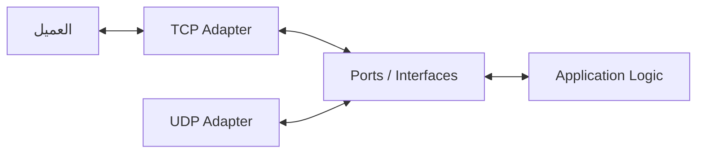
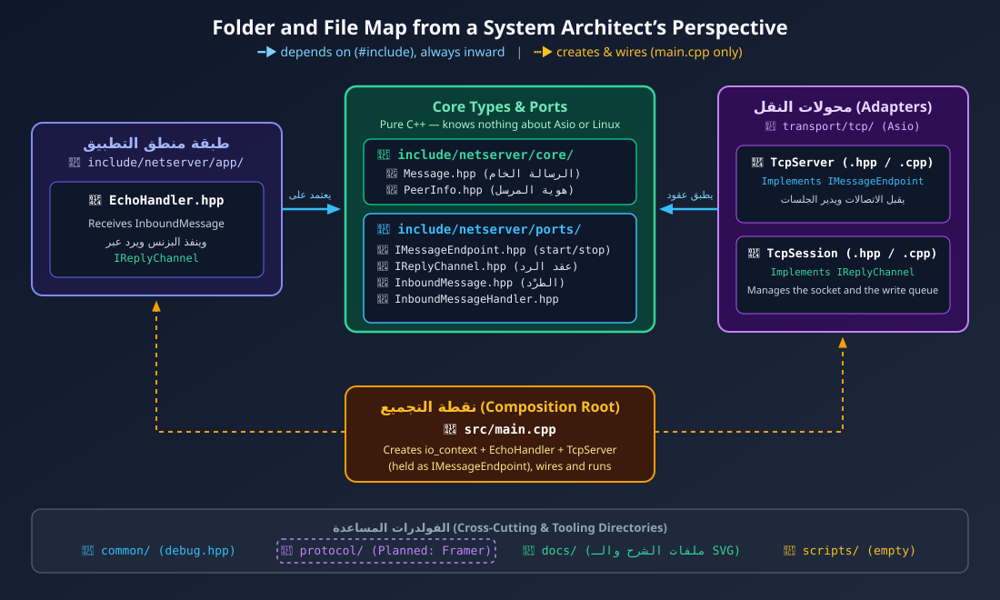
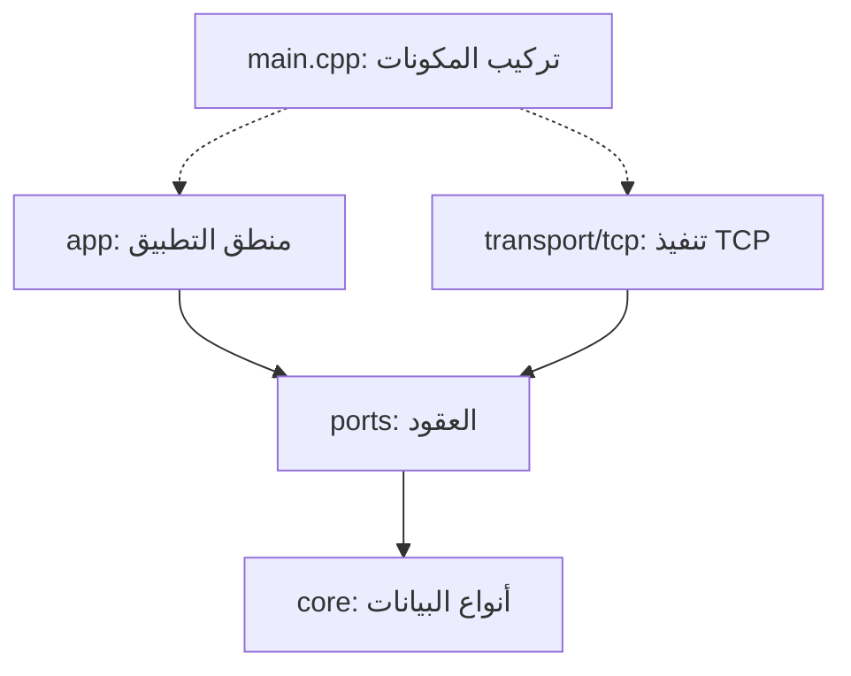

# دليل معمارية النظام وهيكلية المجلدات

**System Architecture & Directory Structure**

> **القاعدة الأساسية:** المعمارية الجيدة تجعل دور كل جزء واضحًا من اسمه ومكانه، وتوضح كيف تتواصل الأجزاء معًا، ومن يعتمد على مَن.
>
> عندما يفتح مطوّر شجرة المشروع (`tree`) للمرة الأولى، يُفترض أن يستطيع تكوين فكرة أولية عن مسؤولية كل طبقة، وحدودها، واتجاه الاعتماد بين مكوّناتها.

يعرض هذا المستند تصميمًا يعتمد على **المعمارية السداسية (Hexagonal Architecture)**، المعروفة أيضًا باسم **Ports and Adapters**. سنشرح الفكرة، ثم نربطها بهيكلية المشروع، ونوضح وظيفة كل مجلد وملف وسبب اختيار أسمائه.

## الفهرس

1. [الفكرة الأساسية: مركز خدمة وقنوات استقبال مختلفة](#1-الفكرة-الأساسية-مركز-خدمة-وقنوات-استقبال-مختلفة)
2. [لماذا نفصل `include/` عن `src/`؟](#2-لماذا-نفصل-include-عن-src)
3. [خريطة المعمارية واتجاه الاعتماد](#3-خريطة-المعمارية-واتجاه-الاعتماد)
4. [شرح المجلدات والملفات](#4-شرح-المجلدات-والملفات)
    * [ال `core/`: نماذج البيانات الأساسية](#41-core-نماذج-البيانات-الأساسية)
    * [ال `ports/`: العقود والواجهات](#42-ports-العقود-والواجهات)
    * [ال `app/`: منطق التطبيق](#43-app-منطق-التطبيق)
    * [ال `transport/tcp/`: تنفيذ النقل عبر TCP](#44-transporttcp-تنفيذ-النقل-عبر-tcp)
    * [المكونات المشتركة و`main.cpp`](#45-المكونات-المشتركة-وmaincpp)
5. [رحلة الرسالة من العميل إلى التطبيق ثم العودة](#5-رحلة-الرسالة-من-العميل-إلى-التطبيق-ثم-العودة)
6. [ما الذي تكسبه من هذا التصميم؟](#6-ما-الذي-تكسبه-من-هذا-التصميم)

---

## 1. الفكرة الأساسية: مركز خدمة وقنوات استقبال مختلفة

تخيّل وجود **مركز خدمة** يتلقى طلبات العملاء من قنوات مختلفة: من خلال الهاتف، أو البريد الإلكتروني، أو نموذج على الموقع. كل قناة لها طريقة مختلفة في استقبال الطلب، لكن القسم المسؤول عن تنفيذ الطلب لا يحتاج إلى معرفة تفاصيل القناة التي استخدمها العميل؛ ما يحتاجه هو طلب واضح ومنظّم، ومعه المعلومات اللازمة للرد على صاحبه.

يمكن ربط هذا المثال بمشروع السيرفر كالتالي:

- **منطق التطبيق (`app/`)** هو القسم الذي يفهم الطلب ويقرر ما الذي يجب فعله. في مثالنا الحالي، يقوم `EchoHandler` باستقبال الرسالة وإعادتها إلى المرسل.
- **المنافذ (`ports/`)** هي العقود التي تحدد شكل التعامل بين منطق التطبيق وبقية النظام. فهي توضّح، مثلًا، كيف يستقبل التطبيق رسالة وكيف يطلب إرسال رد، من دون فرض تفاصيل TCP أو UDP عليه.
- **المحوّلات (`transport/`)** هي المكونات التي تتعامل مع وسيلة الاتصال الفعلية، ثم توفّر البيانات للتطبيق وفق العقد المتفق عليه. محوّل TCP يتعامل مع `Boost.Asio` والـ Socket وعمليات القراءة والكتابة، ويمكن لاحقًا إضافة محوّل UDP بعقد مناسب.

يمكن تلخيص العلاقة بهذه الصورة:



الفكرة ليست أن TCP وUDP متطابقان في السلوك؛ فهما يختلفان في طريقة نقل البيانات وإدارة الاتصال. الفكرة هي أن **منطق التطبيق يعتمد على عقد واضح بدلًا من اعتماده مباشرةً على تفاصيل النقل**، ما يقلّل التغييرات المطلوبة عند إضافة وسيلة اتصال جديدة.

> **ملحوظة:** إضافة `TLS` ليست مجرد استبدال TCP بـ UDP؛ فـ TLS طبقة أمان تُستخدم عادةً فوق TCP، ويعتمد دمجها على تصميم طبقة النقل. لذلك لا نفترض أن كل وسيلة نقل يمكن تبديلها بالأخرى من دون قيود.

---

## 2. لماذا نفصل `include/` عن `src/`؟

في النسخة الأولية من المشروع، كانت ملفات الترويسة (`.hpp`) وملفات التنفيذ (`.cpp`) موجودة بجوار بعضها. فصلها إلى `include/` و`src/` هو اختيار تنظيمي شائع، خصوصًا عندما يكبر المشروع أو عندما نريد إتاحة واجهات للمكونات الأخرى مع إبقاء تفاصيل التنفيذ منفصلة.

### `include/`: الواجهات والتصريحات

يحتوي عادةً على ملفات header files التي تعرّف الكلاسات والأنواع والدوال التي تحتاج المكونات الأخرى إلى معرفتها. هذه الملفات توضّح **ما الذي يتيحه المكوّن**، وليس بالضرورة كل تفاصيل كيفية تنفيذه.

### `src/`: التنفيذ

يحتوي عادةً على ملفات `.cpp` التي تتضمن تنفيذ الدوال والتفاصيل الداخلية. هذا الفصل يساعد على تنظيم المشروع، لكنه لا يعني أن كل ملف في `include/` واجهة عامة بالضرورة؛ فالأمر يتحدد وفق ما يتيحه المشروع فعليًا للمكونات الأخرى.

### لماذا يوجد مجلد `netserver/` داخل `include/`؟

لنفترض أن مسار الملف هو:

```cpp
#include "netserver/core/Message.hpp"
```

وجود اسم المشروع في مسار التضمين يجعل استخدام الملفات أوضح ويقلّل احتمالات الالتباس مع ملفات تحمل أسماء متشابهة في مكونات أخرى. لكنه لا يمنع كل حالات التعارض تلقائيًا؛ لذلك تظل إعدادات التضمين وأسماء الملفات جزءًا من التنظيم الصحيح للمشروع.

---

## 3. خريطة المعمارية واتجاه الاعتماد

توضح الخريطة التالية العلاقة بين المجلدات الأساسية. القاعدة الأهم ليست أسماء المجلدات وحدها، بل **اتجاه الاعتماد**: ينبغي ألا تضطر طبقة منطق التطبيق إلى تضمين تفاصيل تنفيذ TCP أو التعامل مباشرةً مع `asio::ip::tcp::socket`.

إذا كان ملف الرسم موجودًا في المسار المشار إليه، يمكن عرضه هنا:

<p align="center">
  
</p>

ويمكن تصور مسار الرسالة بشكل مبسّط هكذا:



الأسهم المتصلة تعني "يعتمد على" (`#include`)، والأسهم المتقطعة تعني "يُنشئ ويربط" من نقطة التجميع.

هذا رسم مفاهيمي لتوضيح المسؤوليات، وليس قاعدة تلزم كل ملف بتضمين الملفات الظاهرة في الرسم مباشرةً. المهم هو أن تبقى تفاصيل النقل بعيدة عن منطق التطبيق، وأن يتم تركيب المكونات في نقطة واضحة واحدة.

---

## 4. شرح المجلدات والملفات

سنبدأ بالأنواع والعقود التي يحتاج إليها النظام، ثم ننتقل إلى منطق التطبيق، وبعد ذلك إلى تنفيذ TCP والمكونات التي تجمع النظام.

### 4.1 `core/`: نماذج البيانات الأساسية

المقصود بكلمة `core` هو الجزء الذي يحتوي على المفاهيم والأنواع الأساسية التي تتبادلها طبقات النظام. يُفضّل أن تبقى هذه الأنواع مستقلة قدر الإمكان عن تفاصيل الشبكة و`Boost.Asio`، حتى يمكن استخدامها في أكثر من سياق.

<div dir="rtl">
<table>
  <thead>
    <tr>
      <th>الملف</th>
      <th>الوظيفة وسبب التسمية</th>
    </tr>
  </thead>
  <tbody>
    <tr>
      <td><code dir="ltr">Message.hpp</code></td>
      <td>يمثّل رسالة على مستوى التطبيق. قد يحتوي حاليًا على <code dir="ltr">std::string payload</code>. وجود <span dir="ltr">Message</span> بدل تمرير <code dir="ltr">std::string</code> مباشرةً يوفّر مكانًا واحدًا لتطوير نموذج الرسالة لاحقًا، مثل إضافة <code dir="ltr">MessageType</code> أو <code dir="ltr">RequestID</code>، من دون ربط كل أجزاء النظام بالنوع <code dir="ltr">std::string</code> وحده. ومع ذلك، قد يتطلب هذا التطوير تعديل الواجهات التي تستخدم الرسالة؛ فوجود <code dir="ltr">struct</code> لا يضمن وحده عدم الحاجة إلى أي تعديل.</td>
    </tr>
    <tr>
      <td><code dir="ltr">PeerInfo.hpp</code></td>
      <td>يحتوي على معلومات الطرف المقابل (<code dir="ltr">Peer</code>) الذي وصلت منه الرسالة، مثل نوع النقل (<code dir="ltr">TransportType</code>) وعنوان <span dir="ltr">IP</span> والمنفذ، بحسب ما يحتاجه التصميم. يساعد ذلك على فصل بيانات الطرف عن منطق معالجة الرسالة.</td>
    </tr>
  </tbody>
</table>
</div>

من الأفضل ألا يعتمد `core/` على `asio.hpp` لمجرد تمثيل الرسائل أو معلومات الطرف. إذا احتاج نوع أساسي إلى تفاصيل خاصة بالنقل، فهذه علامة تستحق المراجعة لمعرفة ما إذا كانت تلك التفاصيل في الطبقة المناسبة.

لا يعتمد `core/` على أي مجلد آخر في المشروع. لهذا وُضع `InboundMessage.hpp` في `ports/`؛ لأنه يحمل `IReplyChannel`، ولو بقي في `core/` لأصبح `core/` معتمدًا على `ports/` بينما `ports/` يعتمد على `core/` (اعتمادية عكسية بين الطبقات). ملاحظة: `PeerInfo` ما زال يحتوي على `TransportType`، وهو مفهوم نقل؛ نقله إلى `ports/` خيار متاح إذا أردنا `core/` مستقلًا تمامًا عن TCP وUDP.

### 4.2 `ports/`: العقود والواجهات

في نمط **Ports and Adapters**، تمثّل الـ `Ports` نقاط التعامل التي يعرفها منطق التطبيق. وغالبًا ما تُعرّف في C++ باستخدام واجهات مجردة (`abstract classes`) ودوال افتراضية خالصة (`pure virtual functions`). استخدام الحرف `I` في بداية الاسم، مثل `IReplyChannel`، اصطلاح تسمية شائع للإشارة إلى الواجهة، وليس قاعدة في اللغة.

#### `InboundMessage.hpp`

تعني `Inbound` أن الرسالة واردة إلى النظام. يجمع هذا النوع المعلومات التي يحتاج إليها التطبيق لمعالجة الرسالة: `Message` و`PeerInfo` وقناة الرد (`IReplyChannel`). وبهذا تنتقل المعلومات المرتبطة بالطلب كوحدة واحدة بدل تمريرها عبر عدة معاملات منفصلة.

#### `InboundMessageHandler.hpp`

يعرّف نوع الـ callback المشترك:

```cpp
using InboundMessageHandler = std::function<void(const InboundMessage&)>;
```

هذا هو الحد الفاصل الذي يستدعي من خلاله الـ Adapter منطق التطبيق. وجوده في ملف مستقل يسمح لـ `TcpSession` باستخدامه من غير الاعتماد على `IMessageEndpoint` (واجهة دورة حياة السيرفر).

#### `IMessageEndpoint.hpp`

يمثل واجهة التحكم في تشغيل وسيلة النقل وإيقافها: `start(InboundMessageHandler)` و`stop()`. لاحظ الفرق: `IMessageEndpoint` واجهة **النقل** (تشغيل/إيقاف)، أما `InboundMessageHandler` الذي تستقبله فهو واجهة **التطبيق**.

يحتفظ `main.cpp` بالسيرفر كـ `std::unique_ptr<IMessageEndpoint>`، فلا يظهر اسم `TcpServer` إلا في سطر الإنشاء. وعند إضافة `UdpServer`، يمكنه تنفيذ الواجهة نفسها إذا كانت دلالات التشغيل والاستقبال متوافقة معها.

#### `IReplyChannel.hpp`

يوفّر طريقة عامة لطلب إرسال رد، مثل `send(Message)`. لا يحتاج `EchoHandler` إلى معرفة ما إذا كان التنفيذ يستخدم `asio::async_write` على اتصال TCP أو `asio::async_send_to` لإرسال Datagram عبر UDP؛ فهذه تفاصيل تخص المحوّل.

لكن يجب الانتباه إلى أن التنفيذ الداخلي قد يختلف: TCP يقدّم تدفق بايتات موثوقًا ومرتبًا، بينما UDP يرسل Datagram مستقلة ولا ينشئ اتصالًا مماثلًا لاتصال TCP. الواجهة الموحّدة ينبغي أن تعبّر عن العمليات المشتركة فقط، وألا تخفي اختلافات تؤثر فعليًا في سلوك التطبيق.

### 4.3 `app/`: منطق التطبيق

يحتوي هذا المجلد على السلوك الذي يحدد ما الذي يفعله السيرفر بالرسائل بعد استقبالها. هنا نضع منطق التطبيق، لا تفاصيل فتح الـ Socket أو التعامل مع عمليات القراءة والكتابة الخاصة بالنقل.

#### `EchoHandler.hpp`

مسؤول عن معالجة الرسالة على مستوى التطبيق. في مثال الـ Echo، يستقبل `InboundMessage`، ويمكنه تسجيل معلومات عنها (`Log`)، ثم يطلب إرسال الرسالة إلى المرسل عبر قناة الرد:

```cpp
inbound.reply_channel->send(inbound.message);
```

بهذا لا يحتاج `EchoHandler` إلى استدعاء `asio::async_write` أو معرفة نوع الـ Socket. إذا أضفنا محوّل UDP يوفّر العقد المناسب، فقد نتمكن من إعادة استخدام `EchoHandler` كما هو. لكن ذلك يعتمد على توافق دلالات الرسائل والردود؛ فلا يُفترض أن كل تطبيق يعمل مع TCP سيعمل تلقائيًا مع UDP من دون مراجعة.

### 4.4 `transport/tcp/`: تنفيذ النقل عبر TCP

يشير `transport/` إلى المكونات التي تتعامل مع وسيلة نقل البيانات. وجود مجلد فرعي باسم `tcp/` يعزل تنفيذ TCP عن تنفيذ UDP الذي قد يُضاف لاحقًا تحت `transport/udp/`.

#### `TcpServer.hpp` و`TcpServer.cpp`

الاسم `TcpServer` أكثر تحديدًا من `Server`؛ لأنه يوضح نوع النقل الذي ينفّذه هذا المكوّن. من مسؤولياته المعتادة إدارة `tcp::acceptor`، واستقبال الاتصالات عبر `async_accept`، وإنشاء جلسة لكل اتصال جديد، ثم إدارة الجلسات النشطة.

عند إضافة `UdpServer`، لن نحتاج إلى تحميل `TcpServer` مسؤوليات لا تخصه، وسيظل اسم كل مكوّن معبّرًا عن دوره.

#### `TcpSession.hpp` و`TcpSession.cpp`

تدير الجلسة حالة اتصال TCP مع عميل بعينه. قد تشمل مسؤولياتها:

- إدارة عمليات القراءة والكتابة غير المتزامنة على الـ Socket.
- الاحتفاظ بطابور الكتابة (`write queue`) لضمان ترتيب عمليات الإرسال وعدم بدء كتابات متزامنة متعارضة على التدفق نفسه.
- إدارة حالة الجلسة والإغلاق والتعامل مع أخطاء الاتصال.
- الاحتفاظ بمعلومات الطرف المقابل (`PeerInfo`).
- تطبيق حدود للطابور والتعامل مع العملاء البطيئين، وهو ما يرتبط بمفهوم **Backpressure**. التنفيذ الحالي يحدّ عدد الرسائل (`kMaxWriteQueueSize = 64`) وإجمالي البايتات (`kMaxWriteQueueBytes = 1 MiB`) وحجم الرسالة الواحدة (`kMaxMessageSize = 64 KiB`)؛ لأن حد العدد وحده لا يحدّ الذاكرة.
- التنسيق مع مكوّن تأطير الرسائل (`Framer`) عند إضافته.

اسم `TcpSession` اختيار تصميمي يوضح أن الكلاس يدير دورة حياة جلسة TCP، وليس مجرد غلاف رفيع حول Socket. اسم `Connection` صحيح أيضًا في كثير من المشاريع؛ فلا توجد قاعدة عامة تفرض اسمًا واحدًا.

**نقطة تصميم مهمة:** لا تجعل `TcpSession` مسؤولًا عن كل شيء. الأفضل أن تنسّق الجلسة عمليات النقل، بينما يبقى تأطير الرسائل (`LengthPrefixFramer`) مكوّنًا مستقلًا إذا كان ذلك يساعد على فصل المسؤوليات واختباره. الجلسة قد تستخدم الـ Framer، لكن لا يلزم أن تضع كل منطق الترميز وفك الترميز داخله.

ومن الممكن أن تنفّذ `TcpSession` الواجهة `IReplyChannel`. عندها يشير `inbound.reply_channel` إلى قناة الرد الخاصة بالجلسة نفسها، وتستطيع `EchoHandler` طلب الإرسال من دون معرفة تفاصيل TCP. ويجب أن يراعي التنفيذ عمر الكائن والعمليات غير المتزامنة، مثل الاحتفاظ بالجلسة طوال مدة العملية باستخدام أسلوب ملكية مناسب كـ `shared_from_this()` عند الحاجة.

### 4.5 المكونات المشتركة و`main.cpp`

#### `include/netserver/common/debug.hpp`

يمكن وضع الأدوات العامة الصغيرة، مثل ماكرو `DEBUG_PRINT`، في `common/` أو `utils/` بحسب أسلوب تنظيم المشروع. ينبغي ألا يتحول هذا المجلد إلى مكان عشوائي لكل كود يصعب تصنيفه؛ الأفضل أن يكون لكل أداة مشتركة سبب واضح لإقامتها فيه.

#### `src/main.cpp`: نقطة تركيب المكونات (`Composition Root`)

يُستخدم مصطلح **Composition Root** للإشارة إلى نقطة يتركّز فيها إنشاء مكونات النظام وربطها ببعضها. في هذا المشروع، تكون `main.cpp` مكانًا مناسبًا لإنشاء `io_context` و`EchoHandler` و`TcpServer`، وتمرير الاعتمادات اللازمة بينهما، وربط إيقاف النظام بإشارات مثل `SIGINT` و`SIGTERM`.

الهدف هو إبقاء قرار **إنشاء المكونات وربطها** في مكان واضح بدل توزيع هذا القرار على طبقات النظام. ليس من الضروري أن تحتوي `main.cpp` على منطق العمل نفسه؛ دورها الأساسي هو بدء التطبيق وتجميع أجزائه وإدارة دورة تشغيله العامة.

#### `docs/` و`scripts/`

- `docs/`: مستندات التصميم والشرح، مثل ملفات Markdown والرسومات التوضيحية الموجودة في `imgs/`.
- `scripts/`: مخصص لسكريبتات المساعدة والتشغيل والتصحيح (فارغ حاليًا).

يساعد هذا الفصل على إبقاء المجلد الرئيسي للمشروع واضحًا، مع سهولة العثور على الكود والمستندات وأدوات التطوير.

---

## 5. رحلة الرسالة من العميل إلى التطبيق ثم العودة

لنفترض أن العميل يريد إرسال الرسالة المنطقية `Hello`. من المهم التمييز بين **الرسالة على مستوى التطبيق** وبين **دفعة البايتات التي تصل من TCP**: بروتوكول TCP يوفّر تدفق بايتات (`byte stream`)، ولا يضمن أن كل استدعاء قراءة سيعيد رسالة تطبيق كاملة. لذلك نحتاج إلى آلية تأطير (`Framing`) تحدد بداية الرسالة ونهايتها، مثل `LengthPrefixFramer`.

بعد توفر آلية التأطير، يمكن تتبع الرحلة بهذا الشكل:

1. **وصول البيانات إلى النظام:** تصل البيانات عبر الشبكة، وتصبح متاحة للقراءة من خلال Socket Receive Buffer الذي يديره نظام التشغيل. لا يعني ذلك أن استدعاء القراءة سيعيد الرسالة كاملة في مرة واحدة.
2. **القراءة في `TcpSession`:** تنفّذ الجلسة عملية قراءة غير متزامنة. ثم يستخدم مسار المعالجة الـ Framer لتحديد حدود الرسائل وإعادة تكوين رسالة مكتملة من تدفق البايتات.
3. **تكوين `InboundMessage`:** بعد استخراج الرسالة، تُجمع معها معلومات الطرف `PeerInfo` وقناة الرد `IReplyChannel` في كائن `InboundMessage`.
4. **تمرير الرسالة إلى التطبيق:** يستدعي مسار الاستقبال معالج الرسائل المسجّل، مثل `EchoHandler::on_message()`. يتعامل المعالج مع أنواع البيانات والعقود العامة، ولا يحتاج إلى إدارة Socket أو معرفة تفاصيل القراءة في TCP.
5. **طلب الرد:** ينفّذ `EchoHandler`:

   ```cpp
   inbound.reply_channel->send(inbound.message);
   ```

6. **إرسال الرد عبر `TcpSession`:** تعود عملية الإرسال إلى قناة الرد التي تمثل جلسة العميل. تتحقق الجلسة من حدود طابور الكتابة (`Backpressure`)، ثم تضيف الرسالة إلى الطابور وتستخدم `asio::async_write` لإرسال بياناتها. وإذا كان البروتوكول يستخدم Length Prefix، فيجب ترميز الرسالة وفق هذا التأطير قبل إرسالها.

بهذا يبقى منطق التطبيق منفصلًا عن تفاصيل النقل، بينما تتولى `TcpSession` تنسيق عمليات TCP، ويتولى الـ Framer تحديد حدود رسائل التطبيق داخل تدفق البايتات.

---

## 6. ما الذي تكسبه من هذا التصميم؟

- **فصل المسؤوليات:** منطق التطبيق لا يدير الـ Socket، والجلسة لا تحتاج إلى اتخاذ قرارات تخص منطق العمل.
- **سهولة الاختبار:** يمكن اختبار `EchoHandler` باستخدام `IReplyChannel` بديل أو وهمي (`Mock`) دون فتح اتصال شبكي حقيقي.
- **إمكانية التوسع:** يمكن إضافة محوّل نقل آخر، مثل UDP، مع تقييم الفروق في السلوك وتطبيق العقد المناسب.
- **وضوح الاعتماديات:** تبيّن الواجهات كيف تتواصل المكونات، ويظل تجميعها في `main.cpp` بدلًا من تشتيته في النظام.
- **سهولة الصيانة:** عند تغيّر تفاصيل النقل، تتركز التعديلات غالبًا في المحوّل والمكونات المرتبطة به بدل انتشارها في منطق التطبيق.

**الخلاصة:** الهدف من المعمارية ليس زيادة عدد المجلدات أو الواجهات، بل جعل كل مكوّن مسؤولًا عن شيء واضح، وتقليل الاعتماد المباشر بين منطق التطبيق وتفاصيل الشبكة. أضف طبقة أو واجهة عندما تمنحك فصلًا حقيقيًا أو مرونة تحتاج إليها، لا لمجرد اتباع شكل معماري معين.
