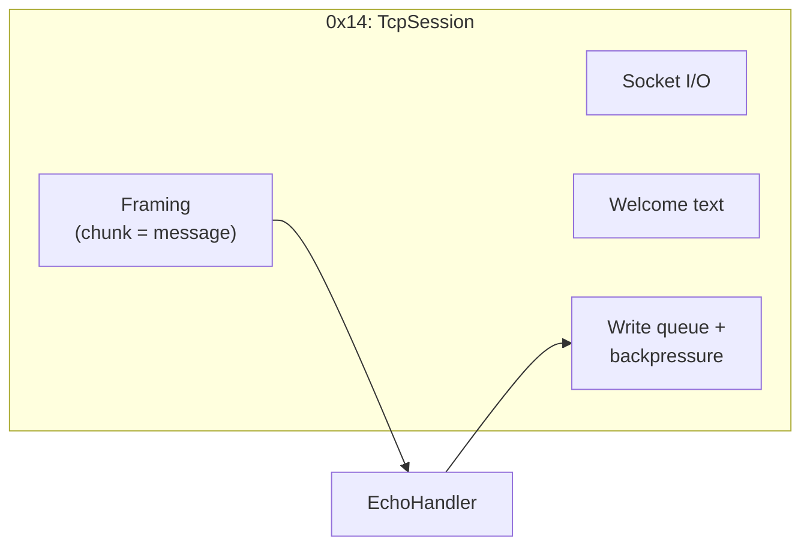
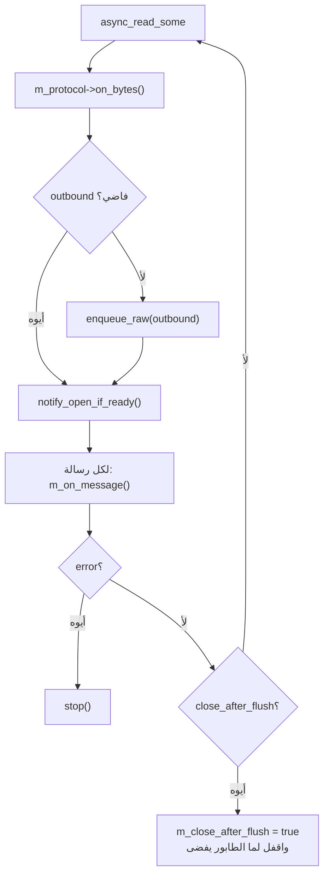
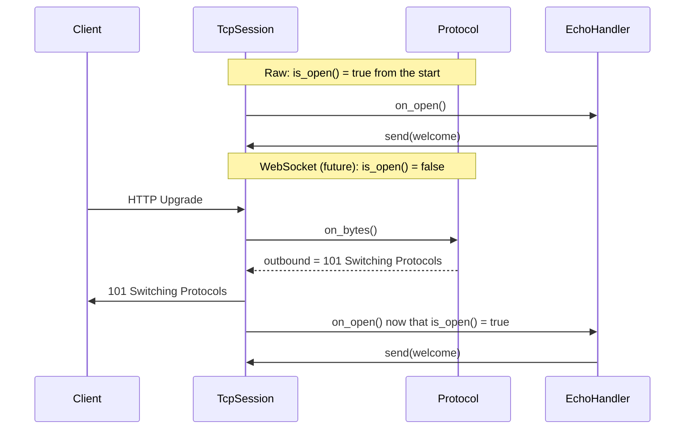
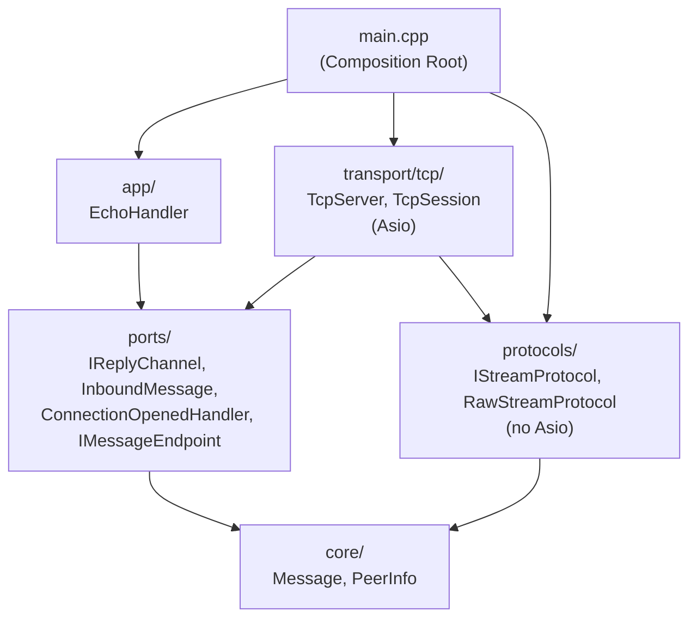

# 0x15 — التغييرات في الكود وفلسفتها

المستند ده بيشرح إيه اللي اتغير في الكود من [lab 0x14](../../../0x14-Networking-basics-asio-tcp/tcp-server-asio/)، وليه اتغير بالشكل ده.

## الفهرس

1. [الخلاصة](#1-الخلاصة)
2. [المشكلة: `TcpSession` كان بيعمل حاجات كتير](#2-المشكلة-tcpsession-كان-بيعمل-حاجات-كتير)
3. [الفلسفة: 5 مبادئ](#3-الفلسفة-5-مبادئ)
4. [التغيير 1: رسائل الترحيب خرجت من طبقة النقل](#4-التغيير-1-رسائل-الترحيب-خرجت-من-طبقة-النقل)
5. [التغيير 2: مجلد `protocols/`](#5-التغيير-2-مجلد-protocols)
6. [التغيير 3: `TcpSession` بقى ناقل بايتات](#6-التغيير-3-tcpsession-بقى-ناقل-بايتات)
7. [التغيير 4: `TcpServer` و`main.cpp`](#7-التغيير-4-tcpserver-وmaincpp)
8. [اتجاه الاعتمادية بعد التغييرات](#8-اتجاه-الاعتمادية-بعد-التغييرات)
9. [تفاصيل صغيرة ليها سبب](#9-تفاصيل-صغيرة-ليها-سبب)
10. [قائمة الملفات](#10-قائمة-الملفات)
11. [إزاي تضيف بروتوكول جديد](#11-إزاي-تضيف-بروتوكول-جديد)

---

## 1. الخلاصة

<div dir="rtl">
<ul>
  <li>
    <strong>السلوك ماتغيرش:</strong>
    <code dir="ltr">nc 127.0.0.1 8080</code> بيطلع نفس اللي كان بيطلع في
    <span dir="ltr">0x14</span> بالظبط.
  </li>
  <li>
    <strong>اللي اتغير هو مكان كل مسؤولية:</strong>
    <ul>
      <li>
        <strong>رسائل الترحيب</strong> بقت في التطبيق
        (<code dir="ltr">EchoHandler::on_open</code>).
      </li>
      <li>
        <strong>فهم البايتات</strong> (فين الرسالة بتبدأ وفين بتخلص) بقى في البروتوكول
        (<code dir="ltr">protocols/</code>).
      </li>
      <li>
        <strong><code dir="ltr">TcpSession</code></strong> بقى بيقرا ويكتب بايتات بس.
      </li>
    </ul>
  </li>
  <li>
    <strong>النتيجة:</strong>
    إضافة بروتوكول جديد، زي <span dir="ltr">Length-Prefix</span> أو
    <span dir="ltr">WebSocket</span>، بقت معناها
    <strong><span dir="ltr">class</span> جديد</strong>، مش تعديل في
    <code dir="ltr">TcpSession</code>.
  </li>
</ul>
</div>

---

## 2. المشكلة: `TcpSession` كان بيعمل حاجات كتير

في 0x14، `TcpSession` كان شايل 4 مسؤوليات:

<div dir="rtl">
<table dir="rtl">
  <thead>
    <tr>
      <th style="text-align: center;">المسؤولية</th>
      <th style="text-align: center;">مثال من الكود</th>
      <th style="text-align: center;">بتتغير إمتى؟</th>
    </tr>
  </thead>
  <tbody>
    <tr>
      <td><strong>النقل (<span dir="ltr">I/O</span>)</strong></td>
      <td><code dir="ltr">async_read_some</code>، و<code dir="ltr">async_write</code>، والـ <span dir="ltr">write queue</span></td>
      <td>لما تغيّر طريقة النقل، زي <span dir="ltr">TLS</span></td>
    </tr>
    <tr>
      <td><strong>البروتوكول (<span dir="ltr">Framing</span>)</strong></td>
      <td>كل <code dir="ltr">async_read_some</code> بتتعامل كرسالة كاملة</td>
      <td>لما تغيّر شكل البايتات، زي <span dir="ltr">Length-Prefix</span> أو <span dir="ltr">WebSocket</span></td>
    </tr>
    <tr>
      <td><strong>التطبيق</strong></td>
      <td><code dir="ltr">send("Welcome to Asio TCP Server!")</code></td>
      <td>لما تغيّر منطق السيرفر نفسه</td>
    </tr>
    <tr>
      <td><strong>دورة حياة الجلسة</strong></td>
      <td><code dir="ltr">start()</code> و<code dir="ltr">stop()</code> و<code dir="ltr">shared_from_this()</code></td>
      <td>نادرًا</td>
    </tr>
  </tbody>
</table>
</div>

المشكلة إن **3 أسباب مختلفة للتغيير** كانوا في نفس الملف. يعني لو عايز تضيف WebSocket، هتعدّل في نفس الكود اللي فيه الـ write queue والـ backpressure، واحتمال تبوّظ حاجة شغالة يبقى كبير.



---

## 3. الفلسفة: 5 مبادئ

### المبدأ 1: افصل حسب سبب التغيير

القاعدة اللي بنمشي عليها: **كل جزء في الكود يبقى ليه سبب واحد بس يتغير عشانه.** (ده الـ Single Responsibility Principle).

<div dir="rtl">
<table dir="rtl">
  <thead>
    <tr>
      <th style="text-align: center;">الطبقة</th>
      <th style="text-align: center;">بتتغير لما...</th>
    </tr>
  </thead>
  <tbody>
    <tr>
      <td><code dir="ltr">app/</code></td>
      <td>منطق السيرفر يتغير، زي إنه يرد بإيه</td>
    </tr>
    <tr>
      <td><code dir="ltr">protocols/</code></td>
      <td>شكل البايتات على السلك يتغير</td>
    </tr>
    <tr>
      <td><code dir="ltr">transport/</code></td>
      <td>طريقة النقل تتغير: <span dir="ltr">TCP</span>، أو <span dir="ltr">UDP</span>، أو <span dir="ltr">TLS</span></td>
    </tr>
    <tr>
      <td><code dir="ltr">main.cpp</code></td>
      <td>طريقة تركيب الأجزاء دي مع بعض تتغير</td>
    </tr>
  </tbody>
</table>
</div>

### المبدأ 2: البروتوكول Sans-I/O

ال **Sans-I/O** معناها "من غير I/O". البروتوكول **مابيلمسش الشبكة خالص**:

- ما يعرفش يعني إيه socket.
- مابيعملش `#include <asio.hpp>`.
- مالوش callbacks async.

هو بس **دالة**: بتدخلها بايتات، وبتطلعلك **قرارات** (رسائل كاملة، وبايتات لازم تتبعت، وهل تقفل الاتصال).

**ليه ده مهم؟**

1. **الاختبار سهل:** تقدر تختبر الـ parser بـ unit test عادي، من غير شبكة ولا event loop.

   ```cpp
   LengthPrefixProtocol p;
   auto ev = p.on_bytes("\x00\x00\x00\x05hel", 7);   // رسالة ناقصة
   assert(ev.messages.empty());
   ev = p.on_bytes("lo", 2);                          // كمّلت
   assert(ev.messages[0].payload == "hello");
   ```

2. **إعادة الاستخدام:** نفس البروتوكول يشتغل على TCP أو على TLS، لأنه مش عارف البايتات جاية منين.
3. **مفيش مشاكل lifetime:** مفيش `shared_from_this` ولا dangling pointers جوه البروتوكول، لأنه مابيستناش حاجة async.

### المبدأ 3: الاعتمادية بتشاور لجوه

الطبقات الداخلية ماتعرفش حاجة عن الطبقات الخارجية:

<div dir="rtl">
<ul>
  <li><code dir="ltr">core/</code> مابتعتمدش على أي حاجة.</li>
  <li><code dir="ltr">protocols/</code> بتعتمد على <code dir="ltr">core/</code> بس، <strong>من غير <span dir="ltr">Asio</span></strong>.</li>
  <li><code dir="ltr">app/</code> بتعتمد على <code dir="ltr">ports/</code> و<code dir="ltr">core/</code> بس.</li>
  <li><code dir="ltr">transport/</code> هي الوحيدة اللي بتعرف <span dir="ltr">Asio</span>.</li>
</ul>
</div>

### المبدأ 4: `main.cpp` هو اللي بيختار (Composition Root)

مفيش class بيقرر لوحده هيستخدم أنهي بروتوكول. `main.cpp` هو اللي بيقول:

> "البورت 8080 هيشتغل بـ `RawStreamProtocol`."

وبكده تقدر بعدين تشغّل بورتين ببروتوكولين مختلفين، من غير ما تغيّر سطر في `TcpServer` أو `TcpSession`.

### المبدأ 5: Refactor من غير ما السلوك يتغير

ال `RawStreamProtocol` بيعمل **بالظبط** اللي `TcpSession` كان بيعمله: كل chunk تبقى رسالة. ده مقصود:

- لو السيرفر اتصرف بشكل مختلف بعد الـ refactor، يبقى فيه bug في الـ refactor نفسه.
- تقدر تتأكد بـ `nc` إن مفيش حاجة باظت، **قبل** ما تضيف أي سلوك جديد.

يعني بنغيّر **الشكل** الأول، وبعدين نغيّر **السلوك**، وعمرنا ما بنعمل الاتنين في نفس الخطوة.

---

## 4. التغيير 1: رسائل الترحيب خرجت من طبقة النقل

### قبل

```cpp
void TcpSession::start()
{
    // ...
    send(Message{"Welcome to Asio TCP Server!\n"});
    send(Message{"Type anything and I will echo it back!\n"});
    read();
}
```

**المشكلة:** طبقة النقل كانت عارفة نص خاص بالتطبيق. ولو البروتوكول WebSocket، النص ده هيروح للعميل **قبل** الـ handshake، والاتصال هيبوظ.

### بعد

ال port جديد في [ConnectionOpenedHandler.hpp](../include/netserver/ports/ConnectionOpenedHandler.hpp):

```cpp
using ConnectionOpenedHandler =
    std::function<void(const PeerInfo&, std::shared_ptr<IReplyChannel>)>;
```

والتطبيق هو اللي بيقرر يبعت إيه في [EchoHandler.hpp](../include/netserver/app/EchoHandler.hpp):

```cpp
void on_open(const PeerInfo& peer, const std::shared_ptr<IReplyChannel>& channel) {
    channel->send(Message{"Welcome to Asio TCP Server!\n"});
    channel->send(Message{"Type anything and I will echo it back!\n"});
}
```

### ليه في `ports/`؟

لأن ده **حد بين التطبيق والعالم الخارجي**: الـ transport بيبلّغ التطبيق إن فيه اتصال جديد. وده نفس سبب وجود `InboundMessageHandler` في `ports/`.

### ليه parameter منفصل في `IMessageEndpoint::start()`؟

```cpp
virtual void start(InboundMessageHandler on_message,
                   ConnectionOpenedHandler on_open) = 0;
```

<div dir="rtl">
<ul>
  <li>
    <span dir="ltr">UDP</span> مالوش <span dir="ltr">"اتصال"</span>، فالـ <code dir="ltr">UdpServer</code> الجاي هيتجاهل <code dir="ltr">on_open</code>. ده مكتوب في تعليق على الـ <span dir="ltr">port</span>.
  </li>
  <li>
    مستخدمناش <span dir="ltr">default argument</span>، لأن الـ <span dir="ltr">default arguments</span> في الدوال الـ <span dir="ltr">virtual</span> بتتحدد حسب <strong>نوع المؤشر</strong> مش نوع الـ <span dir="ltr">object</span>، وده مصدر <span dir="ltr">bugs</span> معروف.
  </li>
</ul>
</div>

---

## 5. التغيير 2: مجلد `protocols/`

```
include/netserver/protocols/
├── IStreamProtocol.hpp
├── IDatagramProtocol.hpp
└── raw/
    ├── RawStreamProtocol.hpp
    └── RawDatagramProtocol.hpp
```

### ليه عقدين مش عقد واحد؟

لأن الـ stream والـ datagram **مختلفين في الطبيعة**:

<div dir="rtl">
<table dir="rtl">
  <thead>
    <tr>
      <th style="text-align: center;">&nbsp;</th>
      <th style="text-align: center;"><code dir="ltr">IStreamProtocol</code> (<span dir="ltr">TCP</span>)</th>
      <th style="text-align: center;"><code dir="ltr">IDatagramProtocol</code> (<span dir="ltr">UDP</span>)</th>
    </tr>
  </thead>
  <tbody>
    <tr>
      <td>الدخل</td>
      <td>بايتات متقطعة، ممكن نص رسالة أو رسالة ونص</td>
      <td><span dir="ltr">datagram</span> كامل</td>
    </tr>
    <tr>
      <td>الحالة (<span dir="ltr">state</span>)</td>
      <td>فيه: <span dir="ltr">buffer</span>، و<span dir="ltr">handshake</span>، و<span dir="ltr">fragments</span></td>
      <td>غالبًا مفيش</td>
    </tr>
    <tr>
      <td>عدد الـ <span dir="ltr">instances</span></td>
      <td><strong>واحد لكل اتصال</strong></td>
      <td><strong>واحد للسيرفر كله</strong></td>
    </tr>
    <tr>
      <td>الدالة الأساسية</td>
      <td><code dir="ltr">on_bytes()</code> بترجع <strong>صفر أو أكتر</strong> من الرسائل</td>
      <td><code dir="ltr">decode()</code> بترجع <strong>رسالة واحدة أو لا شيء</strong></td>
    </tr>
  </tbody>
</table>
</div>

لو حطيناهم في عقد واحد، كان هيبقى فيه دوال مالهاش معنى لنوع من الاتنين.

### `IStreamProtocol`

[IStreamProtocol.hpp](../include/netserver/protocols/IStreamProtocol.hpp)

```cpp
struct ProtocolEvents {
    std::vector<Message> messages;   // complete application messages
    std::string outbound;            // protocol-level bytes: handshake reply, pong, close frame
    bool close_after_flush{false};
    bool error{false};
};

class IStreamProtocol {
public:
    virtual ProtocolEvents on_bytes(const char* data, std::size_t size) = 0;
    virtual std::string encode(const Message& message) = 0;
    virtual bool is_open() const = 0;
};

using StreamProtocolFactory = std::function<std::unique_ptr<IStreamProtocol>()>;
```

#### `ProtocolEvents`: البروتوكول بيرجّع قرارات

البروتوكول مابينفذش حاجة بنفسه، بيرجّع **وصف** للي لازم يحصل، والـ transport هو اللي بينفذ:

| الحقل | معناه | مثال |
|---|---|---|
| `messages` | رسائل كاملة للتطبيق، ممكن تبقى صفر أو أكتر | Length-Prefix: نص رسالة يبقى صفر، رسالتين ملزوقين يبقوا اتنين |
| `outbound` | بايتات **البروتوكول** نفسه، مش التطبيق | رد الـ WebSocket handshake، أو pong |
| `close_after_flush` | اقفل بعد ما تبعت كل اللي في الطابور | WebSocket close frame |
| `error` | البيانات غلط، اقفل على طول | Length-Prefix: الطول أكبر من الحد المسموح |

#### `encode()`

التطبيق بيبعت `Message`، والبروتوكول بيحوّلها لبايتات. في Raw بترجع الـ payload زي ما هو، وفي Length-Prefix هتحط 4 bytes طول قبل الـ payload.

#### `is_open()`

بترجع `false` لحد ما الـ handshake يخلص. في Raw بترجع `true` على طول، وفي WebSocket هترجع `false` لحد ما الـ HTTP Upgrade يخلص.

#### ليه `StreamProtocolFactory` مش instance واحد؟

لأن كل اتصال ليه **state** خاص بيه. لو عميلين بعتوا نص رسالة في نفس الوقت واستخدموا نفس الـ buffer، البايتات هتتلخبط. فالـ `TcpServer` بياخد **مصنع** ويعمل instance جديد لكل اتصال.

### `IDatagramProtocol`

[IDatagramProtocol.hpp](../include/netserver/protocols/IDatagramProtocol.hpp)

```cpp
virtual std::optional<Message> decode(const char* data, std::size_t size) = 0;
virtual std::string encode(const Message& message) = 0;
```

ال `std::nullopt` معناها إن الـ datagram مش سليم ولازم يترمي. في UDP مفيش "اقفل الاتصال"، الـ datagram الغلط بيترمي وخلاص.

### الـ Raw implementations

ال [RawStreamProtocol.hpp](../include/netserver/protocols/raw/RawStreamProtocol.hpp): نفس سلوك 0x14 بالظبط:

```cpp
ProtocolEvents on_bytes(const char* data, std::size_t size) override {
    ProtocolEvents events;
    events.messages.push_back(Message{std::string(data, size)});
    return events;
}
```

ال [RawDatagramProtocol.hpp](../include/netserver/protocols/raw/RawDatagramProtocol.hpp): جاهز للـ `UdpServer`، ومحدش بيستخدمه لسه.

### ليه `protocols/` مش جوه `ports/`؟

ال `ports/` هو الحد بين **التطبيق** والعالم الخارجي. أما `IStreamProtocol` فهو عقد بين **الـ transport** و**البروتوكول**، والاتنين بره التطبيق. التطبيق (`EchoHandler`) **مايعرفش** إن فيه بروتوكول أصلًا، هو بيستقبل `Message` وبيبعت `Message`.

---

## 6. التغيير 3: `TcpSession` بقى ناقل بايتات

[TcpSession.cpp](../src/transport/tcp/TcpSession.cpp)

### الجلسة بقى معاها بروتوكول

```cpp
explicit TcpSession(asio::io_context& io,
                    std::unique_ptr<IStreamProtocol> protocol,
                    MessageHandler on_message,
                    ConnectionOpenedHandler on_open,
                    CloseCallback on_close);
```

`std::unique_ptr` لأن الجلسة **بتملك** البروتوكول بتاعها لوحدها، والبروتوكول بيموت معاها.

### مسار القراءة

قبل كده كانت كل chunk بتروح للتطبيق على طول. دلوقتي بتعدي على البروتوكول الأول:



**ليه الترتيب ده؟**

<div dir="rtl">
<ol>
  <li>
    <strong><code dir="ltr">outbound</code> الأول:</strong>
    لو ده رد <span dir="ltr">handshake</span>، لازم يوصل للعميل
    <strong>قبل</strong> أي رسالة من التطبيق.
  </li>
  <li>
    <strong><code dir="ltr">notify_open_if_ready()</code> بعدها:</strong>
    لو الـ <span dir="ltr">handshake</span> لسه خالص جوه <code dir="ltr">on_bytes()</code>،
    التطبيق يعرف دلوقتي، ورسائل الترحيب تتبعت <strong>بعد</strong> رد الـ <span dir="ltr">handshake</span>.
  </li>
  <li>
    <strong>الرسائل بعد كده:</strong>
    التطبيق يشتغل على الرسائل الكاملة.
  </li>
  <li>
    <strong><code dir="ltr">error</code> و<code dir="ltr">close_after_flush</code> في الآخر:</strong>
    عشان الرسائل الكاملة اللي وصلت قبل الخطأ تتعالج الأول.
  </li>
</ol>
</div>

### `send()` اتقسمت لاتنين

```cpp
void TcpSession::send(Message message)          // للتطبيق: رسالة
{
    if (m_stopped || !m_protocol->is_open()) return;
    enqueue_raw(m_protocol->encode(message));
}

void TcpSession::enqueue_raw(std::string bytes) // داخلي: بايتات جاهزة
{
    // نفس منطق send() القديم: حدود الحجم، والـ backpressure، وwrite()
}
```

<div dir="rtl">
<table dir="rtl">
  <thead>
    <tr>
      <th style="text-align: center;">&nbsp;</th>
      <th style="text-align: center;"><code dir="ltr">send()</code></th>
      <th style="text-align: center;"><code dir="ltr">enqueue_raw()</code></th>
    </tr>
  </thead>
  <tbody>
    <tr>
      <td>مين بيناديها</td>
      <td>التطبيق عن طريق <code dir="ltr">IReplyChannel</code></td>
      <td><code dir="ltr">send()</code>، ومسار القراءة لما يكون فيه <code dir="ltr">outbound</code></td>
    </tr>
    <tr>
      <td>الدخل</td>
      <td><code dir="ltr">Message</code> (بيانات التطبيق)</td>
      <td><code dir="ltr">std::string</code> (بايتات جاهزة للسلك)</td>
    </tr>
    <tr>
      <td>بتعدي على <code dir="ltr">encode()</code>؟</td>
      <td>أيوه</td>
      <td>لأ، البايتات متجهزة خلاص</td>
    </tr>
  </tbody>
</table>

<p><strong>الفايدة:</strong> الـ <span dir="ltr">write queue</span> والـ <span dir="ltr">backpressure</span> اتكتبوا <strong>مرة واحدة</strong> وكل البروتوكولات بتستخدمهم. ولو حد كتب <span dir="ltr">WebSocket</span> بعدين، مش هيحتاج يكتب <span dir="ltr">write queue</span> تاني.</p>
</div>

### `on_open` بيستنى البروتوكول

```cpp
void TcpSession::notify_open_if_ready()
{
    if (m_open_notified || m_stopped || !m_protocol->is_open()) return;
    m_open_notified = true;
    if (m_on_open) m_on_open(m_peer, shared_from_this());
}
```

<div dir="rtl">
<p>بتتنادى في مكانين:</p>
<ul>
  <li>
    <strong>في <code dir="ltr">start()</code>:</strong>
    مع <span dir="ltr">Raw</span>، <code dir="ltr">is_open()</code> بترجع <code dir="ltr">true</code> على طول،
    فالترحيب بيتبعت فورًا زي <span dir="ltr">0x14</span>.
  </li>
  <li>
    <strong>بعد كل <code dir="ltr">on_bytes()</code>:</strong>
    مع <span dir="ltr">WebSocket</span>، أول ما الـ <span dir="ltr">handshake</span> يخلص.
  </li>
</ul>
<p><code dir="ltr">m_open_notified</code> بيضمن إن <code dir="ltr">on_open</code> تتنادى <strong>مرة واحدة بس</strong>.</p>
</div>



### `close_after_flush`

بعض البروتوكولات محتاجة **تبعت حاجة وبعدين تقفل**، زي الـ WebSocket close frame. لو قفلنا على طول، الـ frame مش هيوصل.

<div dir="rtl">
<ul>
  <li>
    لما البروتوكول يطلب <code dir="ltr">close_after_flush</code>، الجلسة
    <strong>بتبطل تقرا</strong> وبتعلّم <code dir="ltr">m_close_after_flush = true</code>.
  </li>
  <li>
    لو الطابور فاضي أصلًا، بتقفل فورًا.
  </li>
  <li>
    غير كده، الـ <span dir="ltr">write callback</span> بيقفل لما آخر عنصر في الطابور يتبعت:
  </li>
</ul>
</div>

```cpp
if (!m_write_queue.empty()) {
    write();
} else if (m_close_after_flush) {
    stop();
}
```

---

## 7. التغيير 4: `TcpServer` و`main.cpp`

### `TcpServer` بياخد factory

```cpp
TcpServer(asio::io_context& io, std::uint16_t port, StreamProtocolFactory make_protocol);

// في accept()
auto session = std::make_shared<TcpSession>(
    m_io, m_make_protocol(), m_on_message, m_on_open, /* on_close */ ...);
```

<div dir="rtl">
<p><code dir="ltr">TcpServer</code> مايعرفش أنهي بروتوكول بيشتغل، هو بس بينادي المصنع مع كل اتصال جديد.</p>
</div>

### `main.cpp` هو اللي بيختار

```cpp
auto server = std::make_unique<netserver::TcpServer>(io, 8080, [] {
    return std::make_unique<netserver::RawStreamProtocol>();
});

server->start(
    [&echo_handler](const netserver::InboundMessage& msg) { echo_handler.on_message(msg); },
    [&echo_handler](const netserver::PeerInfo& peer,
                    std::shared_ptr<netserver::IReplyChannel> channel) {
        echo_handler.on_open(peer, channel);
    });
```

لما يبقى فيه `LengthPrefixProtocol`، تشغيل بورت تاني بيه هيبقى سطرين في `main.cpp` بس.

---

## 8. اتجاه الاعتمادية بعد التغييرات



<div dir="rtl">
<p><strong>لاحظ:</strong></p>
<ul>
  <li>
    <strong><code dir="ltr">app/</code> و<code dir="ltr">protocols/</code> مابيعرفوش بعض:</strong>
    التطبيق مايعرفش إن الرسالة جت بـ <span dir="ltr">Raw</span> ولا <span dir="ltr">Length-Prefix</span>.
  </li>
  <li>
    <strong><code dir="ltr">transport/</code> بس هو اللي بيعرف <span dir="ltr">Asio</span>:</strong>
    <code dir="ltr">protocols/</code> و<code dir="ltr">app/</code> <span dir="ltr">C++</span> عادي،
    وتقدر تختبرهم من غير شبكة.
  </li>
</ul>
</div>

---

## 9. تفاصيل صغيرة ليها سبب

<div dir="rtl">
<table dir="rtl">
  <thead>
    <tr>
      <th style="text-align: center;">التفصيلة</th>
      <th style="text-align: center;">السبب</th>
    </tr>
  </thead>
  <tbody>
    <tr>
      <td><code dir="ltr">if (!m_stopped) read();</code> بعد <code dir="ltr">on_open</code> في <code dir="ltr">start()</code></td>
      <td>التطبيق ممكن يقفل الجلسة جوه <code dir="ltr">on_open</code>، زي لو رفض الـ <span dir="ltr">IP</span></td>
    </tr>
    <tr>
      <td><code dir="ltr">if (m_stopped) return;</code> جوه لوب الرسائل</td>
      <td>التطبيق ممكن يقفل الجلسة وهو بيعالج رسالة، أو الـ <span dir="ltr">backpressure</span> يقفلها</td>
    </tr>
    <tr>
      <td><code dir="ltr">send()</code> بترجع على طول لو <code dir="ltr">!is_open()</code></td>
      <td>مايتبعتش بيانات تطبيق قبل الـ <span dir="ltr">handshake</span></td>
    </tr>
    <tr>
      <td><code dir="ltr">if (m_stopped) return;</code> في الـ <span dir="ltr">write callback</span></td>
      <td>الجلسة ممكن تكون اتقفلت من مكان تاني، فمش لازم نكمل كتابة</td>
    </tr>
    <tr>
      <td>بعد <code dir="ltr">close_after_flush</code> مفيش <code dir="ltr">read()</code></td>
      <td>البروتوكول قال "خلصنا"، فأي بايتات بعد كده مالهاش لازمة</td>
    </tr>
    <tr>
      <td>حد <code dir="ltr">kMaxMessageSize</code> بقى على البايتات بعد <code dir="ltr">encode()</code></td>
      <td>ده الحجم الحقيقي اللي هيتكتب على السلك، بالـ <span dir="ltr">header</span> بتاع البروتوكول</td>
    </tr>
    <tr>
      <td><code dir="ltr">[[maybe_unused]]</code> على <code dir="ltr">peer</code> في <code dir="ltr">on_open</code></td>
      <td>بيتستخدم في <code dir="ltr">DEBUG_PRINT</code> بس، فمن غير <code dir="ltr">DEBUG_TRACE</code> المترجم كان بيطلع <span dir="ltr">warning</span></td>
    </tr>
  </tbody>
</table>
</div>

---

## 10. قائمة الملفات

<div dir="rtl">
<table dir="rtl">
  <thead>
    <tr>
      <th style="text-align: center;">الملف</th>
      <th style="text-align: center;">الحالة</th>
      <th style="text-align: center;">التغيير</th>
    </tr>
  </thead>
  <tbody>
    <tr>
      <td><code dir="ltr">ports/ConnectionOpenedHandler.hpp</code></td>
      <td><strong>جديد</strong></td>
      <td><span dir="ltr">port</span> لحدث فتح الاتصال</td>
    </tr>
    <tr>
      <td><code dir="ltr">ports/IMessageEndpoint.hpp</code></td>
      <td>معدّل</td>
      <td><code dir="ltr">start()</code> بقت تاخد <code dir="ltr">on_open</code></td>
    </tr>
    <tr>
      <td><code dir="ltr">protocols/IStreamProtocol.hpp</code></td>
      <td><strong>جديد</strong></td>
      <td><code dir="ltr">ProtocolEvents</code>، و<code dir="ltr">IStreamProtocol</code>، و<code dir="ltr">StreamProtocolFactory</code></td>
    </tr>
    <tr>
      <td><code dir="ltr">protocols/IDatagramProtocol.hpp</code></td>
      <td><strong>جديد</strong></td>
      <td>عقد الـ <span dir="ltr">datagram</span></td>
    </tr>
    <tr>
      <td><code dir="ltr">protocols/raw/RawStreamProtocol.hpp</code></td>
      <td><strong>جديد</strong></td>
      <td>سلوك <span dir="ltr">0x14</span></td>
    </tr>
    <tr>
      <td><code dir="ltr">protocols/raw/RawDatagramProtocol.hpp</code></td>
      <td><strong>جديد</strong></td>
      <td>للـ <span dir="ltr">UDP</span> بعدين</td>
    </tr>
    <tr>
      <td><code dir="ltr">app/EchoHandler.hpp</code></td>
      <td>معدّل</td>
      <td><code dir="ltr">on_open()</code> فيها رسائل الترحيب</td>
    </tr>
    <tr>
      <td><code dir="ltr">transport/tcp/TcpSession.hpp/.cpp</code></td>
      <td>معدّل</td>
      <td>
        بياخد بروتوكول، و<code dir="ltr">enqueue_raw()</code>،
        و<code dir="ltr">notify_open_if_ready()</code>، و<code dir="ltr">close_after_flush</code>
      </td>
    </tr>
    <tr>
      <td><code dir="ltr">transport/tcp/TcpServer.hpp/.cpp</code></td>
      <td>معدّل</td>
      <td>بياخد <code dir="ltr">StreamProtocolFactory</code> و<code dir="ltr">on_open</code></td>
    </tr>
    <tr>
      <td><code dir="ltr">src/main.cpp</code></td>
      <td>معدّل</td>
      <td>بيختار <code dir="ltr">RawStreamProtocol</code>، وبيربط <code dir="ltr">on_open</code></td>
    </tr>
  </tbody>
</table>
</div>

---

## 11. إزاي تضيف بروتوكول جديد

<div dir="rtl">
<p>مثال: <code dir="ltr">LengthPrefixProtocol</code>.</p>
<ol>
  <li>
    اعمل <code dir="ltr">protocols/length_prefix/LengthPrefixProtocol.hpp</code>
    يطبّق <code dir="ltr">IStreamProtocol</code>:
    <ul>
      <li>
        <code dir="ltr">on_bytes()</code>: يجمّع البايتات في <span dir="ltr">buffer</span>،
        ويطلّع كل رسالة كاملة (4 <span dir="ltr">bytes</span> طول + <span dir="ltr">payload</span>)،
        ويرجّع <code dir="ltr">error = true</code> لو الطول أكبر من الحد.
      </li>
      <li>
        <code dir="ltr">encode()</code>: يحط 4 <span dir="ltr">bytes</span> طول
        (<span dir="ltr">big-endian</span>) قبل الـ <span dir="ltr">payload</span>.
      </li>
      <li>
        <code dir="ltr">is_open()</code>: ترجع <code dir="ltr">true</code>.
      </li>
    </ul>
  </li>
  <li>
    اكتب <span dir="ltr">unit tests</span> للحالات دي:
    <ul>
      <li>رسالة كاملة.</li>
      <li>رسالة مقسومة على أكتر من <code dir="ltr">on_bytes()</code>.</li>
      <li>رسالتين ملزوقين في <code dir="ltr">on_bytes()</code> واحدة.</li>
      <li>طول أكبر من الحد.</li>
    </ul>
  </li>
  <li>
    في <code dir="ltr">main.cpp</code>، اعمل <code dir="ltr">TcpServer</code> تاني
    على بورت تاني بـ <span dir="ltr">factory</span> بترجع <code dir="ltr">LengthPrefixProtocol</code>.
  </li>
</ol>
<p>
  <strong>مش هتحتاج تلمس:</strong>
  <code dir="ltr">TcpSession</code>، ولا <code dir="ltr">TcpServer</code>،
  ولا <code dir="ltr">EchoHandler</code>. وده كان الهدف من التغييرات كلها.
</p>
</div>
