# 0x15 — UML للكود الحالي

المخططات دي بتوصف الكود الموجود في `include/` و`src/` دلوقتي.

## الفهرس

<ol>
  <li>
    <a href="#1-class-diagrams">Class Diagrams</a>
    <ul>
      <li><a href="#11-core-البيانات-الأساسية">1.1 <code dir="ltr">core/</code>: البيانات الأساسية</a></li>
      <li><a href="#12-ports-حدود-التطبيق">1.2 <code dir="ltr">ports/</code>: حدود التطبيق</a></li>
      <li><a href="#13-app-منطق-التطبيق">1.3 <code dir="ltr">app/</code>: منطق التطبيق</a></li>
      <li><a href="#14-protocols-بروتوكولات-الـ-stream">1.4 <code dir="ltr">protocols/</code>: بروتوكولات الـ stream</a></li>
      <li><a href="#15-protocols-بروتوكولات-الـ-datagram">1.5 <code dir="ltr">protocols/</code>: بروتوكولات الـ datagram</a></li>
      <li><a href="#16-transporttcp-tcpserver">1.6 <code dir="ltr">transport/tcp/</code>: <code dir="ltr">TcpServer</code></a></li>
      <li><a href="#17-transporttcp-tcpsession">1.7 <code dir="ltr">transport/tcp/</code>: <code dir="ltr">TcpSession</code></a></li>
      <li><a href="#18-الصورة-الكاملة">1.8 الصورة الكاملة</a></li>
    </ul>
  </li>
  <li><a href="#2-الملكية-والعمر">الملكية والعمر</a></li>
  <li><a href="#3-sequence-اتصال-جديد">Sequence: اتصال جديد</a></li>
  <li><a href="#4-sequence-رسالة-echo">Sequence: رسالة echo</a></li>
  <li><a href="#5-sequence-الإغلاق-بـ-ctrlc">Sequence: الإغلاق بـ Ctrl+C</a></li>
  <li><a href="#6-state-دورة-حياة-tcpsession">State: دورة حياة <code dir="ltr">TcpSession</code></a></li>
  <li><a href="#7-package-diagram">Package Diagram</a></li>
</ol>

---

## 1. Class Diagrams

بدل رسمة واحدة كبيرة، هنبني الصورة **طبقة طبقة**، من جوه لبره: نبدأ بالبيانات الأساسية، وبعدين الحدود، وبعدين التطبيق، وبعدين البروتوكولات، وفي الآخر طبقة النقل.

في كل رسمة، الكلاسات الجديدة بتظهر بكل تفاصيلها. أما الكلاسات اللي **اتشرحت قبل كده** فبتظهر كصندوق فاضي فيه الاسم بس، عشان تركز على الجديد.

### إزاي تقرا الأسهم

<table dir="rtl">
  <thead>
    <tr>
      <th style="text-align: center;">السهم</th>
      <th style="text-align: center;">المعنى</th>
      <th style="text-align: center;">مثال</th>
    </tr>
  </thead>
  <tbody>
    <tr>
      <td><code dir="ltr">&lt;|..</code></td>
      <td>Realization: الكلاس بيطبّق interface</td>
      <td><code dir="ltr">TcpSession</code> بيطبّق <code dir="ltr">IReplyChannel</code></td>
    </tr>
    <tr>
      <td><code dir="ltr">*--</code></td>
      <td>Composition: الجزء بيموت مع الكل</td>
      <td><code dir="ltr">TcpSession</code> بيملك <code dir="ltr">IStreamProtocol</code> لوحده</td>
    </tr>
    <tr>
      <td><code dir="ltr">o--</code></td>
      <td>Aggregation: ملكية مشتركة أو مرجع</td>
      <td><code dir="ltr">TcpServer</code> و callbacks Asio شايلين <code dir="ltr">shared_ptr&lt;TcpSession&gt;</code></td>
    </tr>
    <tr>
      <td><code dir="ltr">--&gt;</code></td>
      <td>Association: بيحتفظ بقيمة من النوع ده</td>
      <td><code dir="ltr">PeerInfo</code> فيه <code dir="ltr">TransportType</code></td>
    </tr>
    <tr>
      <td><code dir="ltr">..&gt;</code></td>
      <td>Dependency: بيستخدمه بس</td>
      <td><code dir="ltr">EchoHandler</code> بيستخدم <code dir="ltr">IReplyChannel</code></td>
    </tr>
  </tbody>
</table>

<table dir="rtl">
  <thead>
    <tr>
      <th style="text-align: center;">الرمز جوه الكلاس</th>
      <th style="text-align: center;">المعنى</th>
    </tr>
  </thead>
  <tbody>
    <tr>
      <td><code dir="ltr">+</code> / <code dir="ltr">-</code></td>
      <td>public / private</td>
    </tr>
    <tr>
      <td><code dir="ltr">*</code> بعد الدالة</td>
      <td>pure virtual</td>
    </tr>
    <tr>
      <td><code dir="ltr">$</code> بعد العضو</td>
      <td><code dir="ltr">static</code></td>
    </tr>
    <tr>
      <td><code dir="ltr">&lt;&lt;interface&gt;&gt;</code></td>
      <td>class فيه pure virtual functions بس</td>
    </tr>
    <tr>
      <td><code dir="ltr">&lt;&lt;function&gt;&gt;</code></td>
      <td><code dir="ltr">using X = std::function&lt;...&gt;</code>، مش class حقيقي</td>
    </tr>
  </tbody>
</table>

---

### 1.1 `core/`: البيانات الأساسية

أبسط طبقة: أنواع بيانات عادية، **مابتعتمدش على أي حاجة**، وكل الطبقات التانية بتستخدمها.

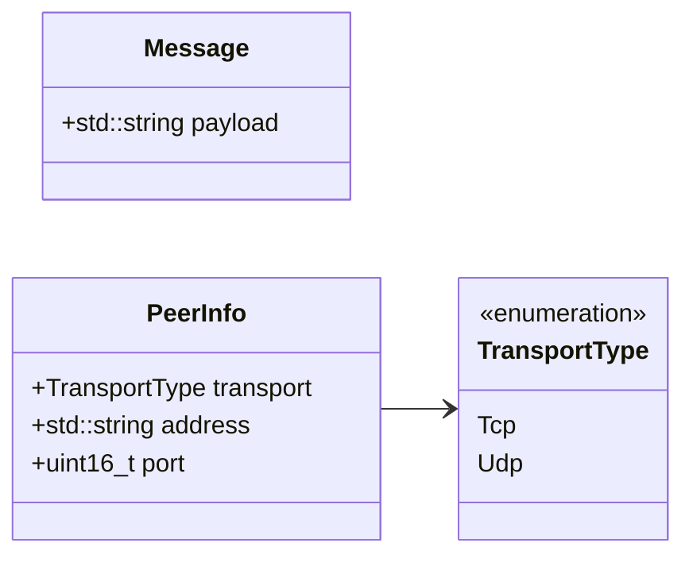

<table dir="rtl">
  <thead>
    <tr>
      <th style="text-align: center;">النوع</th>
      <th style="text-align: center;">بيمثل إيه</th>
    </tr>
  </thead>
  <tbody>
    <tr>
      <td><code dir="ltr">Message</code></td>
      <td>وحدة البيانات اللي التطبيق بيشوفها. فيها <code dir="ltr">payload</code> بس.</td>
    </tr>
    <tr>
      <td><code dir="ltr">PeerInfo</code></td>
      <td>مين اللي على الطرف التاني: العنوان والبورت ونوع النقل.</td>
    </tr>
    <tr>
      <td><code dir="ltr">TransportType</code></td>
      <td><code dir="ltr">Tcp</code> أو <code dir="ltr">Udp</code>.</td>
    </tr>
  </tbody>
</table>

---

### 1.2 `ports/`: حدود التطبيق

ال `ports/` هي **العقود** اللي بتحدد إزاي التطبيق بيتكلم مع العالم الخارجي. فيه 3 اتجاهات:

- **من النقل للتطبيق:** `InboundMessageHandler` و`ConnectionOpenedHandler`.
- **من التطبيق للنقل:** `IReplyChannel`.
- **من `main.cpp` للنقل:** `IMessageEndpoint`، عشان يشغّل السيرفر ويوقفه.

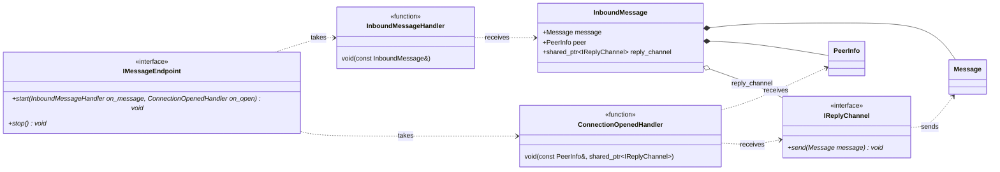

<table dir="rtl">
  <thead>
    <tr>
      <th style="text-align: center;">العقد</th>
      <th style="text-align: center;">الاتجاه</th>
      <th style="text-align: center;">مين بيناديه</th>
      <th style="text-align: center;">مين بينفذه</th>
    </tr>
  </thead>
  <tbody>
    <tr>
      <td><code dir="ltr">IMessageEndpoint</code></td>
      <td>من <code dir="ltr">main.cpp</code> للنقل</td>
      <td><code dir="ltr">main.cpp</code></td>
      <td><code dir="ltr">TcpServer</code></td>
    </tr>
    <tr>
      <td><code dir="ltr">ConnectionOpenedHandler</code></td>
      <td>من النقل للتطبيق</td>
      <td><code dir="ltr">TcpSession</code></td>
      <td>lambda في <code dir="ltr">main.cpp</code> بتنادي <code dir="ltr">EchoHandler::on_open</code></td>
    </tr>
    <tr>
      <td><code dir="ltr">InboundMessageHandler</code></td>
      <td>من النقل للتطبيق</td>
      <td><code dir="ltr">TcpSession</code></td>
      <td>lambda في <code dir="ltr">main.cpp</code> بتنادي <code dir="ltr">EchoHandler::on_message</code></td>
    </tr>
    <tr>
      <td><code dir="ltr">IReplyChannel</code></td>
      <td>من التطبيق للنقل</td>
      <td><code dir="ltr">EchoHandler</code></td>
      <td><code dir="ltr">TcpSession</code></td>
    </tr>
  </tbody>
</table>

**لاحظ:** `InboundMessage` شايل `reply_channel` جواه، فالتطبيق بيستلم الرسالة **ومعاها** الطريقة اللي يرد بيها، من غير ما يعرف هي رايحة فين.

---

### 1.3 `app/`: منطق التطبيق

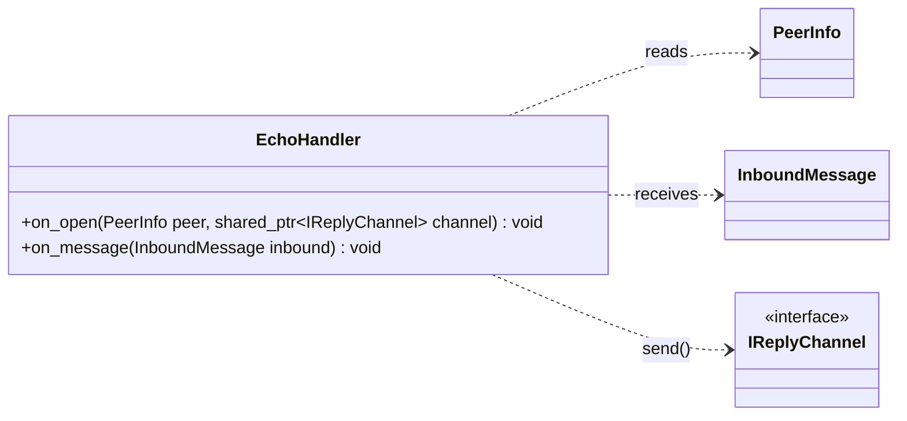

<table dir="rtl">
  <thead>
    <tr>
      <th style="text-align: center;">الدالة</th>
      <th style="text-align: center;">بتعمل إيه</th>
    </tr>
  </thead>
  <tbody>
    <tr>
      <td><code dir="ltr">on_open()</code></td>
      <td>بتبعت رسالتين الترحيب أول ما الاتصال يبقى جاهز.</td>
    </tr>
    <tr>
      <td><code dir="ltr">on_message()</code></td>
      <td>بترجّع نفس الرسالة عن طريق <code dir="ltr">reply_channel-&gt;send()</code>.</td>
    </tr>
  </tbody>
</table>

**لاحظ:**

<ul>
  <li>
    <code dir="ltr">EchoHandler</code> <strong>مابيعرفش</strong> <code dir="ltr">TcpSession</code>
    ولا Asio ولا أي بروتوكول. كل اللي يعرفه هو أنواع
    <code dir="ltr">ports/</code> و<code dir="ltr">core/</code>.
  </li>
  <li>
    <strong>مابيورثش من أي interface:</strong>
    <code dir="ltr">main.cpp</code> بيربطه بالسيرفر عن طريق lambdas،
    فهو مش محتاج يعرف <code dir="ltr">IMessageEndpoint</code> ولا <code dir="ltr">TcpServer</code>.
  </li>
</ul>

---

### 1.4 `protocols/`: بروتوكولات الـ stream

البروتوكول هو اللي **بيفهم البايتات**: بياخد بايتات خام ويطلّع رسائل، وبياخد رسالة ويطلّع بايتات. وهو Sans-I/O، يعني مابيعرفش socket ولا Asio.

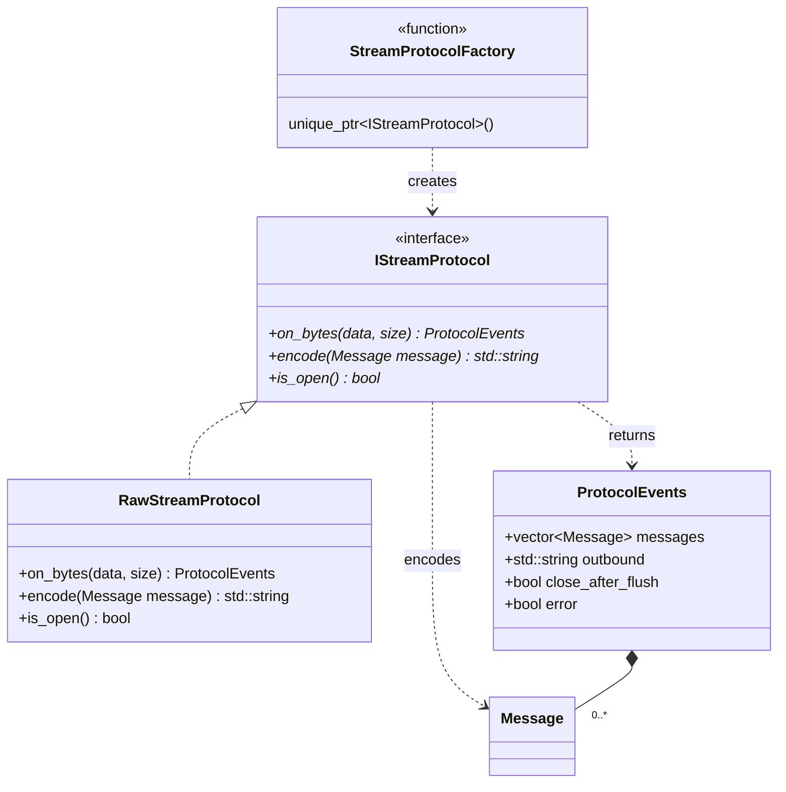

<table dir="rtl">
  <thead>
    <tr>
      <th style="text-align: center;">الدالة</th>
      <th style="text-align: center;">الدخل</th>
      <th style="text-align: center;">الخرج</th>
    </tr>
  </thead>
  <tbody>
    <tr>
      <td><code dir="ltr">on_bytes()</code></td>
      <td>بايتات خام من الـ socket</td>
      <td><code dir="ltr">ProtocolEvents</code>: رسائل كاملة، وبايتات لازم تتبعت، وقرار الإغلاق</td>
    </tr>
    <tr>
      <td><code dir="ltr">encode()</code></td>
      <td><code dir="ltr">Message</code> من التطبيق</td>
      <td>بايتات جاهزة للسلك</td>
    </tr>
    <tr>
      <td><code dir="ltr">is_open()</code></td>
      <td>—</td>
      <td><code dir="ltr">false</code> لحد ما الـ handshake يخلص</td>
    </tr>
  </tbody>
</table>

**لاحظ:**

<ul>
  <li>
    <code dir="ltr">RawStreamProtocol</code> هو الـ implementation الوحيد دلوقتي،
    وبيعمل نفس سلوك 0x14: كل chunk رسالة،
    والـ payload بيتبعت زي ما هو.
  </li>
  <li>
    <code dir="ltr">StreamProtocolFactory</code> موجود عشان
    <strong>كل اتصال ياخد instance لوحده</strong>،
    لأن البروتوكولات اللي فيها framing بيبقى ليها
    state خاص بكل اتصال.
  </li>
</ul>

---

### 1.5 `protocols/`: بروتوكولات الـ datagram

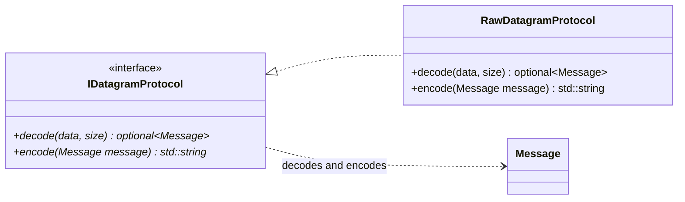

**الاتنين دول مفيش حد بيستخدمهم دلوقتي**، لأن مفيش `UdpServer` لسه.

---

### 1.6 `transport/tcp/`: `TcpServer`

أول كلاس بيعرف Asio. شغلته إنه **يقبل الاتصالات** ويعمل لكل اتصال `TcpSession` ومعاها بروتوكول جديد من الـ factory.

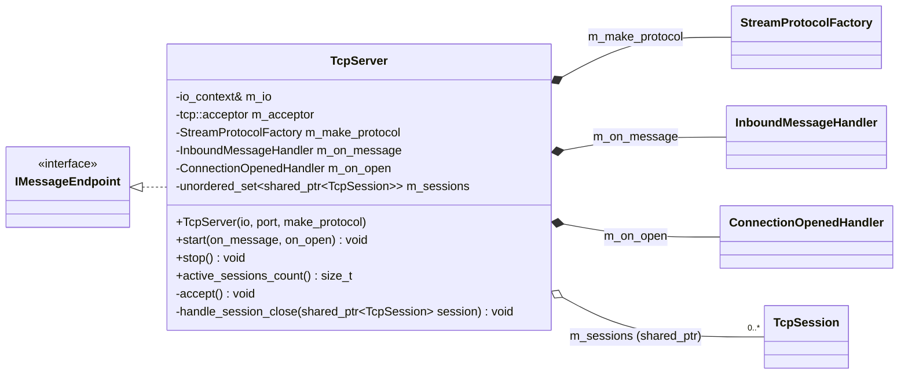

<table dir="rtl">
  <thead>
    <tr>
      <th style="text-align: center;">العضو</th>
      <th style="text-align: center;">دوره</th>
    </tr>
  </thead>
  <tbody>
    <tr>
      <td><code dir="ltr">m_acceptor</code></td>
      <td>بيسمع على البورت وبيقبل الاتصالات</td>
    </tr>
    <tr>
      <td><code dir="ltr">m_make_protocol</code></td>
      <td>بيعمل بروتوكول جديد لكل اتصال</td>
    </tr>
    <tr>
      <td><code dir="ltr">m_on_message</code> و<code dir="ltr">m_on_open</code></td>
      <td>بيتخزنوا في <code dir="ltr">start()</code>، وبيتنسخوا لكل جلسة جديدة</td>
    </tr>
    <tr>
      <td><code dir="ltr">m_sessions</code></td>
      <td>الجلسات الشغالة، عشان <code dir="ltr">stop()</code> يقدر يقفلها كلها</td>
    </tr>
    <tr>
      <td><code dir="ltr">handle_session_close()</code></td>
      <td>الجلسة بتناديها لما تتقفل، عشان تتشال من <code dir="ltr">m_sessions</code></td>
    </tr>
  </tbody>
</table>

---

### 1.7 `transport/tcp/`: `TcpSession`

أكبر كلاس في المشروع. بيمثل **اتصال واحد مع عميل واحد**.

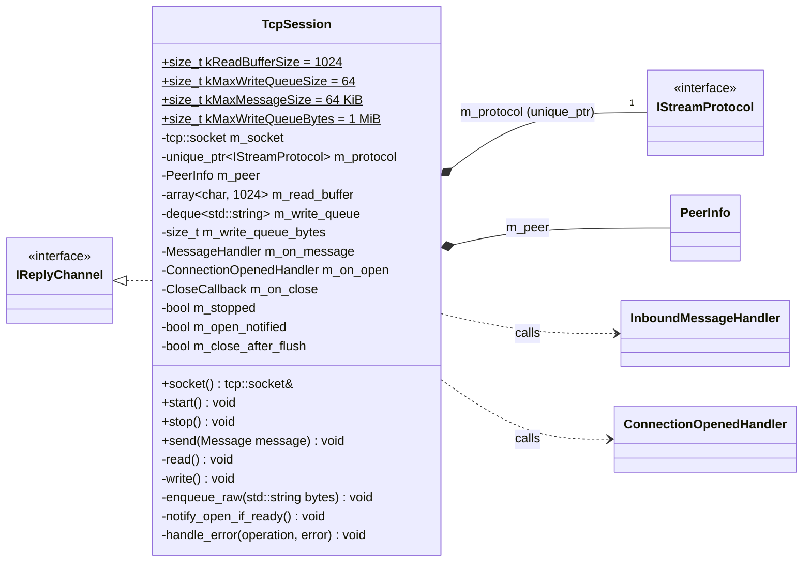

أعضاء الكلاس كتير، فده تقسيمهم حسب المسؤولية:

<table dir="rtl">
  <thead>
    <tr>
      <th style="text-align: center;">المسؤولية</th>
      <th style="text-align: center;">الأعضاء</th>
    </tr>
  </thead>
  <tbody>
    <tr>
      <td><strong>قراءة وكتابة الـ socket</strong></td>
      <td><code dir="ltr">m_socket</code>، <code dir="ltr">m_read_buffer</code>، <code dir="ltr">read()</code>، <code dir="ltr">write()</code></td>
    </tr>
    <tr>
      <td><strong>طابور الكتابة والـ backpressure</strong></td>
      <td><code dir="ltr">m_write_queue</code>، <code dir="ltr">m_write_queue_bytes</code>، <code dir="ltr">enqueue_raw()</code>، والـ 4 ثوابت <code dir="ltr">k...</code></td>
    </tr>
    <tr>
      <td><strong>التعامل مع البروتوكول</strong></td>
      <td><code dir="ltr">m_protocol</code>، <code dir="ltr">send()</code>، <code dir="ltr">notify_open_if_ready()</code>، <code dir="ltr">m_open_notified</code>، <code dir="ltr">m_close_after_flush</code></td>
    </tr>
    <tr>
      <td><strong>مناداة التطبيق</strong></td>
      <td><code dir="ltr">m_on_message</code>، <code dir="ltr">m_on_open</code>، <code dir="ltr">m_peer</code></td>
    </tr>
    <tr>
      <td><strong>دورة الحياة</strong></td>
      <td><code dir="ltr">start()</code>، <code dir="ltr">stop()</code>، <code dir="ltr">handle_error()</code>، <code dir="ltr">m_stopped</code>، <code dir="ltr">m_on_close</code></td>
    </tr>
  </tbody>
</table>

**لاحظ:**

<ul>
  <li>
    <strong><code dir="ltr">TcpSession</code> بيلعب دورين:</strong>
    هو الـ adapter بتاع الـ socket،
    وهو كمان الـ <code dir="ltr">IReplyChannel</code> اللي التطبيق بيرد عليه.
    عشان كده <code dir="ltr">InboundMessage::reply_channel</code> بيشاور على الجلسة نفسها.
  </li>
  <li>
    <strong>الجلسة بتملك البروتوكول بـ <code dir="ltr">unique_ptr</code></strong>،
    فكل جلسة ليها بروتوكول لوحدها، والبروتوكول بيموت معاها.
  </li>
  <li>
    <strong><code dir="ltr">m_on_close</code></strong>
    هي lambda من <code dir="ltr">TcpServer</code> بتنادي
    <code dir="ltr">handle_session_close()</code>.
    عشان كده مفيش سهم مباشر من <code dir="ltr">TcpSession</code> لـ <code dir="ltr">TcpServer</code>.
  </li>
</ul>

---

### 1.8 الصورة الكاملة

دلوقتي بعد ما شفنا كل طبقة لوحدها، دي كل الكلاسات مع بعض، **بالأسماء بس**، عشان تشوف إزاي الطبقات بتتوصل ببعض:

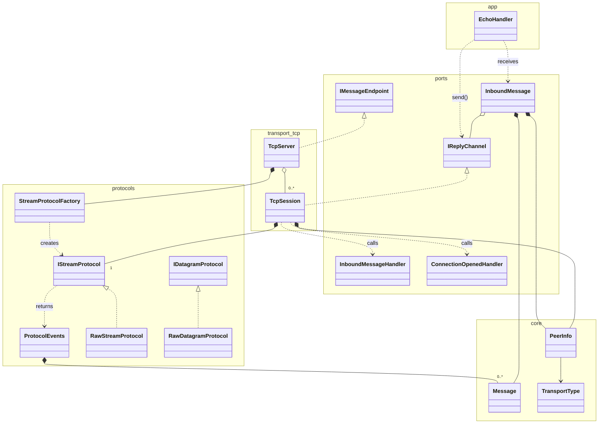

---

## 2. الملكية والعمر

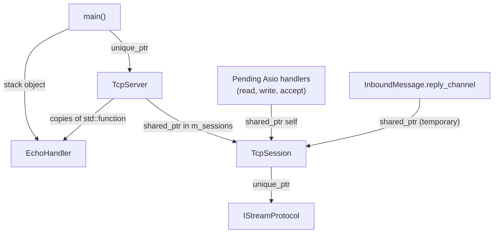

<table dir="rtl">
  <thead>
    <tr>
      <th style="text-align: center;">الـ Object</th>
      <th style="text-align: center;">مين بيملكه</th>
      <th style="text-align: center;">بيموت إمتى</th>
    </tr>
  </thead>
  <tbody>
    <tr>
      <td><code dir="ltr">TcpServer</code></td>
      <td><code dir="ltr">main()</code> عن طريق <code dir="ltr">unique_ptr</code></td>
      <td>آخر <code dir="ltr">main()</code></td>
    </tr>
    <tr>
      <td><code dir="ltr">EchoHandler</code></td>
      <td><code dir="ltr">main()</code> على الـ stack</td>
      <td>آخر <code dir="ltr">main()</code></td>
    </tr>
    <tr>
      <td><code dir="ltr">TcpSession</code></td>
      <td><code dir="ltr">m_sessions</code>، وأي async handler شغال</td>
      <td>لما يتشال من <code dir="ltr">m_sessions</code> ومايبقاش فيه handler شايله</td>
    </tr>
    <tr>
      <td><code dir="ltr">IStreamProtocol</code></td>
      <td><code dir="ltr">TcpSession</code> لوحده</td>
      <td>مع الجلسة</td>
    </tr>
  </tbody>
</table>

---

## 3. Sequence: اتصال جديد

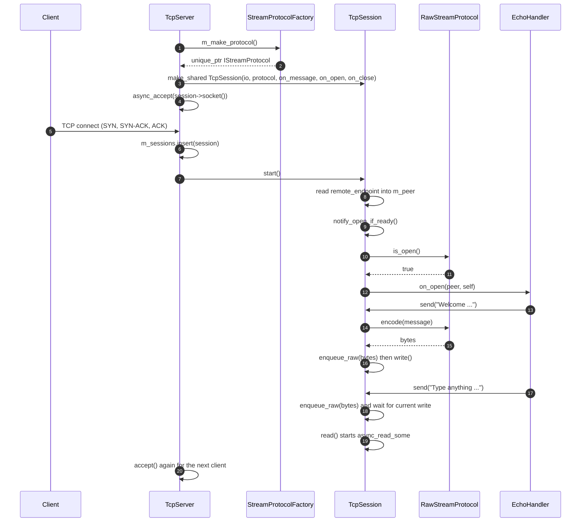

---

## 4. Sequence: رسالة echo

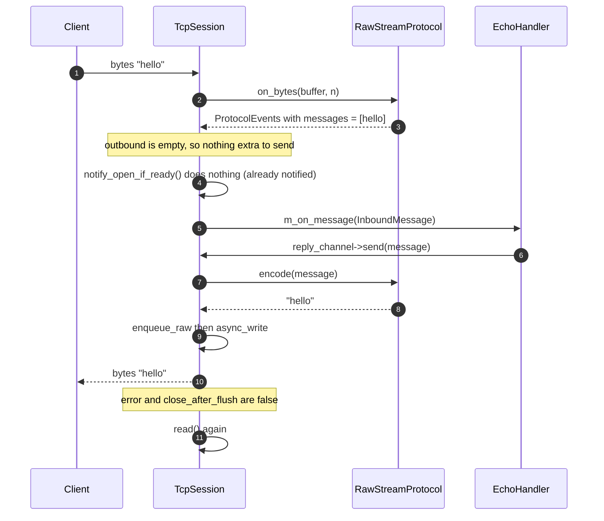

---

## 5. Sequence: الإغلاق بـ Ctrl+C

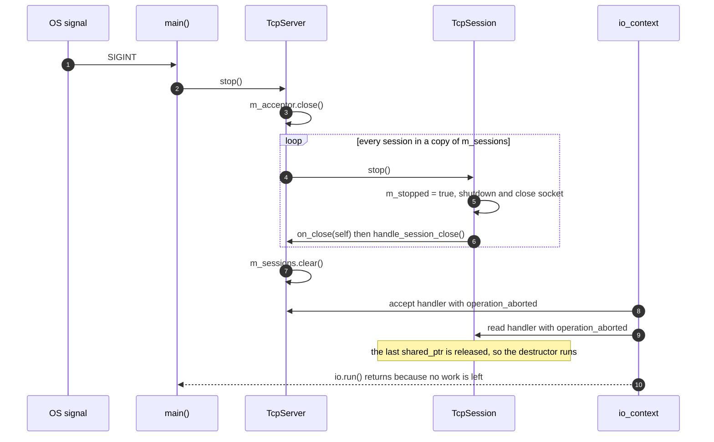

---

## 6. State: دورة حياة `TcpSession`

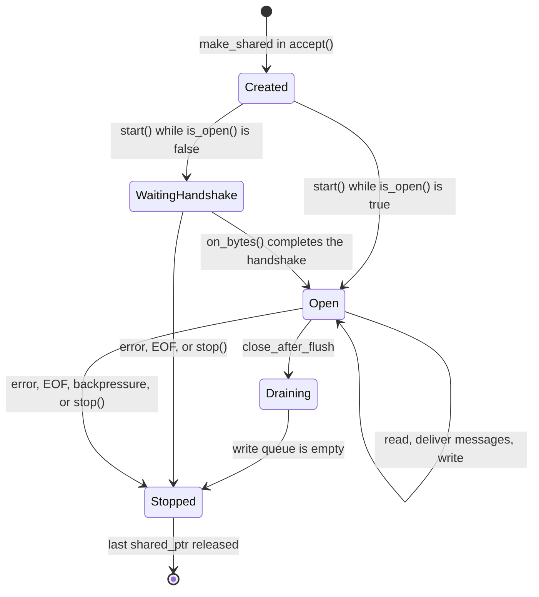

<table dir="rtl">
  <thead>
    <tr>
      <th style="text-align: center;">الحالة</th>
      <th style="text-align: center;">الفلاج المقابل في الكود</th>
    </tr>
  </thead>
  <tbody>
    <tr>
      <td>WaitingHandshake</td>
      <td><code dir="ltr">m_open_notified == false</code> و<code dir="ltr">is_open() == false</code> (مش بيحصل مع Raw)</td>
    </tr>
    <tr>
      <td>Open</td>
      <td><code dir="ltr">m_open_notified == true</code></td>
    </tr>
    <tr>
      <td>Draining</td>
      <td><code dir="ltr">m_close_after_flush == true</code></td>
    </tr>
    <tr>
      <td>Stopped</td>
      <td><code dir="ltr">m_stopped == true</code></td>
    </tr>
  </tbody>
</table>

---

## 7. Package Diagram

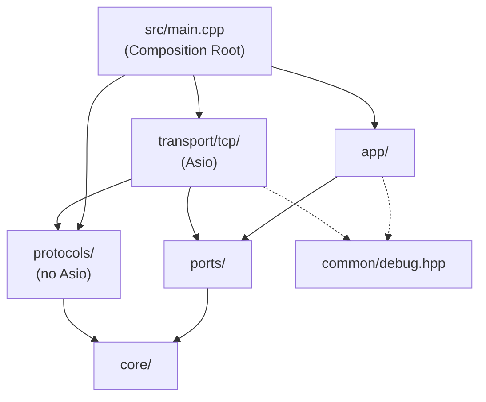

**القاعدة:** الأسهم بتشاور ناحية `core/` بس. `app/` و`protocols/` مابيعرفوش بعض، و`transport/tcp/` هو الوحيد اللي بيعمل `#include <asio.hpp>`.